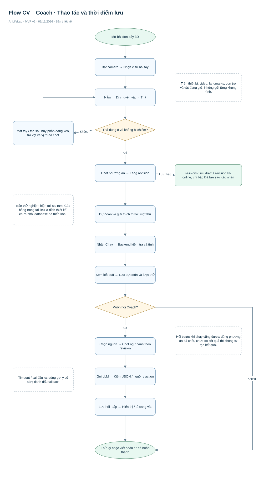
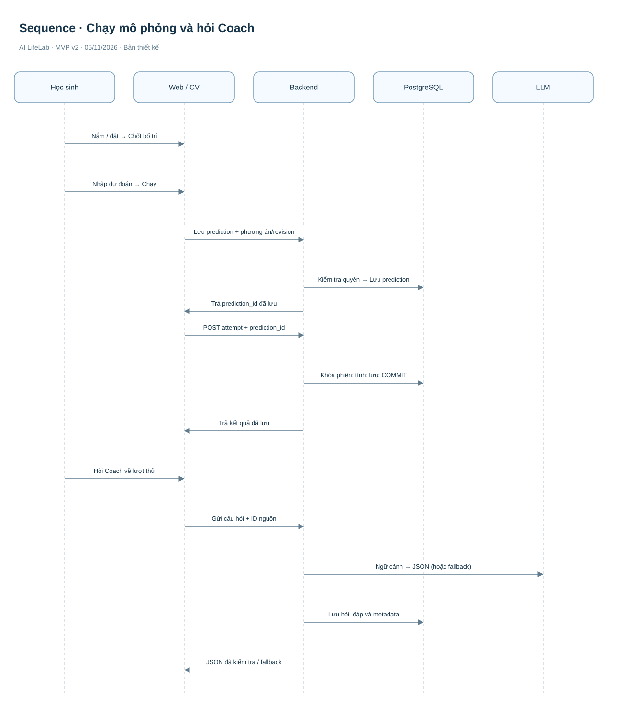
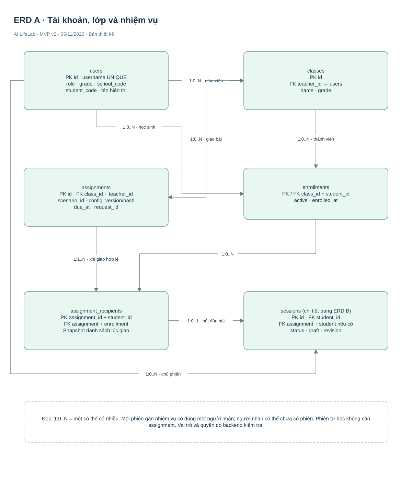
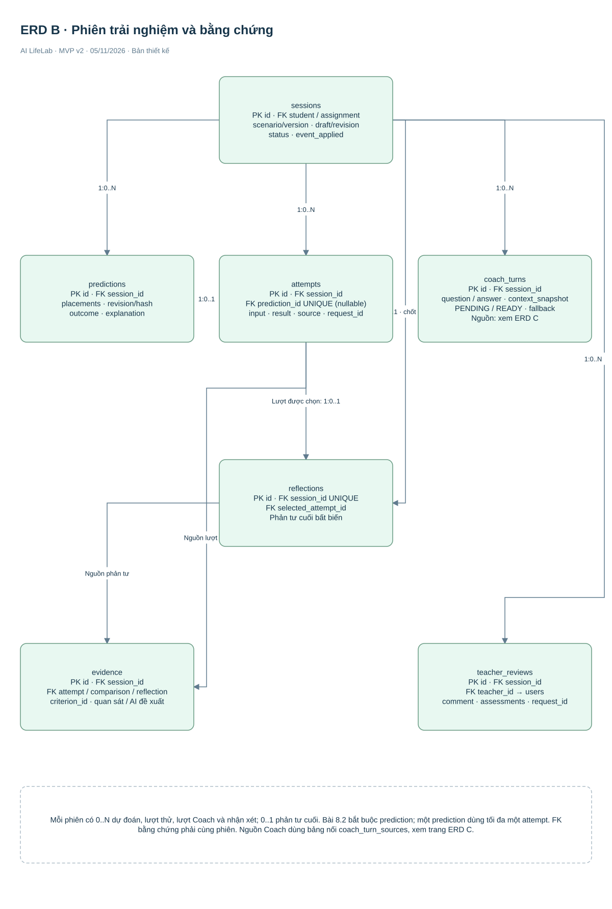

# AI LifeLab — CV, Chat Coach và dữ liệu cần lưu

**Cập nhật:** 05/11/2026. **Triển khai trước:** một bài đòn bẩy trên bàn thực hành 3D. Các bài khác làm sau.

[Database chốt toàn project](database/AI-LifeLab-Database-Toan-du-an.html). [Về tài liệu chính](AI-LifeLab-Phan-tich-Thiet-ke-v2.html). [Sơ đồ chỉnh sửa trong diagrams.net](AI-LifeLab-System-v2.drawio). [SQL thiết kế 13 bảng](schema-v2.sql).

Đây là thiết kế đích. Mã thử nghiệm đang phát triển mới dùng bộ nhớ tạm, chưa có PostgreSQL, tài khoản hay lưu tiến trình lâu dài. Không hiểu các sơ đồ dưới đây là toàn bộ chức năng đã được triển khai.

## 0. Hiểu đúng yêu cầu tương tự video tham khảo

Tham khảo [video người dùng cung cấp](https://www.youtube.com/shorts/bh3BgfsSSqc). Đã đối chiếu các khung hình có trang sách, mô hình điện và đèn 3D trên bàn. Căn cứ quan sát xác nhận hướng trình bày vật thể 3D với chú thích; chưa đủ để khẳng định video có nhận diện tay qua camera hoặc LLM Coach. Hai chức năng này là phần AI LifeLab thiết kế bổ sung theo yêu cầu của người dùng, không phải tính năng đã được xác nhận của video.

| Ý tưởng cần giữ | Cách áp dụng vào AI LifeLab | Giới hạn phải nói rõ |
|---|---|---|
| Vật thể có hình khối, nằm trong một không gian thực hành | Thanh, điểm tựa và hai vật trên bàn 3D; có thể đổi góc nhìn bằng điều khiển giao diện | Không phải chỉ đổi màu một sơ đồ phẳng; chưa yêu cầu tái tạo hình thức cuốn sách |
| Tác động trực tiếp lên mô hình | Tay tiếp cận vật, nắm vật, di chuyển rồi thả; vật đi theo trong lúc kéo | Camera ánh xạ tay lên mặt phẳng ảo, không đo độ sâu chính xác hoặc tạo lực cản |
| Mô hình có phản hồi dễ quan sát | Đổi trạng thái chọn/giữ; thả khớp ô; sau bước chạy, thanh nghiêng hoặc cân bằng | Hình nghiêng là minh họa kết quả mômen, không dự đoán góc quay/tốc độ thật |
| Chú thích gắn với thứ đang tìm hiểu | Vật có tên và khối lượng; khi học sinh chọn vật để hỏi, Coach dùng đúng ID vật và ngữ cảnh lượt thử | Tô sáng là hành động cho phép; Coach không tự thay bố trí |

CV trong bản này phải thể hiện tay đang tác động lên vật 3D, không chỉ dùng cử chỉ để bấm các nút. Khi bắt đầu nắm phải có dấu hiệu xác nhận và nhận biết vật thuộc tay nào. Học sinh dùng hai tay giữ hai vật khác nhau; nếu nhận diện không ổn định phải báo hoặc hủy rõ ràng, không âm thầm đổi tay giữ vật.

Coach phải gắn với hoạt động đang làm. Ví dụ học sinh chọn B và hỏi “Vì sao phía này hạ?”, backend cung cấp focused_object_id = B, phương án và ID lượt thử được chọn. Câu trả lời cần bám số liệu của lượt đó; không tự hiểu “phía này” từ hình ảnh camera. focused_object_id chỉ A/B và được lưu trong context_snapshot nếu có.

### Tiêu chí đối chiếu khi nghiệm thu

| Mã | Phải kiểm tra bằng chạy thử |
|---|---|
| REF-01 | Có cảnh bàn thực hành 3D, chiều sâu và vật thể nhận biết rõ; góc nhìn không làm che vị trí đặt |
| REF-02 | Khi tay di chuyển trong lúc nắm, vật thực sự đi theo; mở tay thả hoặc hủy có phản hồi rõ |
| REF-03 | Hai tay không cùng chiếm một vật; mất nhận diện không làm vật nhảy sang vị trí khác |
| REF-04 | Coach trả lời về đúng vật/phiên/lượt đang được chọn; tô sáng đúng đối tượng khi được phép |
| REF-05 | Nhìn được hậu quả của phương án và có thể thử lại, đối chiếu hai kết quả |

Đây là cam kết thiết kế và bộ tiêu chí cần thử, chưa phải xác nhận đã đạt. Phiên bản hiện tại tách giai đoạn bố trí và nhấn Chạy; nếu cần thanh phản ứng vật lý liên tục trong khi cầm, đó là yêu cầu khác phải bổ sung mô hình và tiêu chí riêng. Không tuyên bố trải nghiệm tương đương thực hành có lực thật hoặc sao chép chính xác mọi tương tác trong video.

## 1. Ba phần làm ba nhiệm vụ

| Phần | Nhận gì? | Làm gì? | Trả gì? |
|---|---|---|---|
| CV trên thiết bị | Khung hình camera | Nhận landmarks; xác nhận nắm, di chuyển và thả; gắn tay với vật | Hành động hợp lệ trên mô hình 3D |
| Bộ mô phỏng | Vị trí vật đã chốt và cấu hình bài | Kiểm tra đầu vào; tính mômen hai phía | Cân bằng hoặc hướng nghiêng và số liệu |
| LLM Coach | Nhiệm vụ, câu hỏi, phương án/dự đoán và lượt thử liên quan | Hỏi dẫn dắt, giải thích, gợi ý và hỗ trợ phản tư | Văn bản cùng ID nguồn; có thể đề xuất tô sáng A/B |

CV không chấm đúng/sai; LLM không quyết định kết quả vật lý. Camera không tạo cảm giác lực thật. Cách biểu diễn là 3D nhưng các vị trí đặt vẫn rời rạc; không phải kéo vật tự do trong không gian thực được đo chính xác.

## 2. Học sinh thao tác bằng tay như thế nào?

| Bước | Động tác | Phản hồi |
|---|---|---|
| Chuẩn bị | Chọn dùng camera, cấp quyền, đưa tay vào khung | Hiện dấu vị trí tay và trạng thái nhận diện |
| Tiếp cận | Di chuyển tay tới hình chiếu của vật | Hiện đối tượng có thể nắm |
| Nắm | Khép cái–trỏ đủ ổn định | Một vật được khóa cho một tay |
| Kéo | Giữ khép ngón, di chuyển tay | Chiếu vị trí tay lên mặt phẳng thao tác ảo; vật 3D đi theo |
| Thả | Mở ngón ở ô hợp lệ | Vật khớp vào ô; tăng revision của phương án |
| Thử | Nhập dự đoán và nhấn Chạy | Tính kết quả chính thức; minh họa thanh nghiêng hoặc cân bằng |
| Điều chỉnh | Đổi vị trí, dự đoán và chạy lại | Thêm lượt thử; không ghi đè lượt trước |

Hai tay có thể thao tác hai vật. Không cho cùng nắm một vật hoặc chốt hai vật vào cùng ô. Mất tay, giao tay mơ hồ hoặc thả sai thì hủy phần kéo chưa chốt; giữ bố trí đã xác nhận. Khi đang giữ vật, chưa cho chạy. Luôn có thao tác thay thế bằng chuột/bàn phím.

Revision là số lần phương án thay đổi. Ví dụ revision 3 là A ở −4 và B ở +2; chuyển A sang −3 tạo revision 4. Dự đoán của revision 3 không được dùng cho phương án revision 4.

## 3. Flow CV–Chat và thời điểm lưu



Ngoài vị trí Hỏi Coach sau chạy trong flow chính, học sinh được hỏi trước khi chạy. Khi đó Coach dùng bố trí đã chốt và chế độ PREDICT/HINT; không được nói rằng đã có kết quả khi chưa chạy. Hỏi Coach không làm thay đổi bố trí.

## 4. Một lượt hỏi Coach

| Bước | Xử lý |
|---|---|
| 1. Học sinh hỏi | Nhập câu hỏi, chọn mục đích như giải thích hoặc so sánh |
| 2. Chọn nguồn | Trước chạy: bố trí + revision. Sau chạy: ID lượt thử đã lưu. So sánh: 2 ID khác nhau cùng phiên |
| 3. Backend chốt ngữ cảnh | Kiểm quyền; lấy nguồn từ máy chủ; ghi snapshot và hash, không tin kết quả do client gửi |
| 4. Gọi LLM | Gửi ngữ cảnh giới hạn và lịch sử cần thiết; không gửi camera hoặc tên thật |
| 5. Kiểm tra | Schema, độ dài, ID nguồn và action trong danh sách cho phép |
| 6. Trả lời | Hiển thị câu hỏi/gợi ý; chỉ tô sáng vật khi action hợp lệ |
| 7. Lưu | Ghi hỏi–đáp, snapshot ngữ cảnh, nguồn và metadata; lỗi dùng fallback có nhãn |

Coach chỉ được gọi khi học sinh yêu cầu hoặc chấp nhận gợi ý. Không gọi LLM theo từng khung hình hay từng centimet di chuyển. Khi model lỗi, học sinh vẫn chạy và hoàn thành bài được.



## 5. Dữ liệu tạm trên thiết bị và dữ liệu lưu lâu dài

| Dữ liệu | Nơi tồn tại | Có lưu database không? |
|---|---|---|
| Video camera, landmarks bàn tay | Bộ nhớ trình duyệt phục vụ nhận thao tác | Không |
| Con trỏ, vật đang giữ, vị trí kéo chưa chốt | Trạng thái giao diện | Không |
| Góc nhìn bàn 3D, hiệu ứng minh họa nghiêng | Giao diện | Không bắt buộc trong MVP |
| Vị trí vật đã chốt | Phương án nháp | Có, vào sessions.draft sau xác nhận lưu |
| Dự đoán và phương án dùng để chạy | Dữ liệu học tập | Có, predictions |
| Kết quả chính thức | Dữ liệu học tập | Có, attempts |
| Hội thoại và nguồn ngữ cảnh | Dữ liệu hỗ trợ học | Có, coach_turns |
| Lời giải thích cuối và nhận xét | Dữ liệu học tập | Có, reflections/evidence/teacher_reviews |

Không lưu toàn bộ đường đi của tay. Tắt tab khi chưa đồng bộ có thể mất phần tạm; chỉ hiện Đã lưu khi máy chủ xác nhận. Chính sách lưu/xóa hội thoại cần được chốt với đơn vị triển khai trước sử dụng thật.

## 6. Từ điển dữ liệu trọng tâm

| Bảng | Trường cần hiểu | Ý nghĩa |
|---|---|---|
| sessions | id, student_id, scenario_id, scenario_version | Phiên thuộc ai, làm bài và phiên bản nào |
| sessions | draft, revision, status | Bố trí đã chốt, lần thay đổi, trạng thái |
| predictions | session_id, draft_revision, placements_json, plan_hash | Gắn dự đoán với đúng phương án |
| predictions | predicted_outcome, explanation | Hướng nghiêng dự đoán và lý do |
| attempts | session_id, prediction_id, input, result, source | Lượt thử, dự đoán nguồn, bố trí, kết quả và cách thao tác |
| attempts | client_request_id, request_hash, created_at | Chống chạy trùng và biết thời điểm |
| coach_turns | session_id, mode, question, answer, followup_question | Mục đích hỏi, câu hỏi và trả lời |
| coach_turns | context_snapshot, context_hash; bảng coach_turn_sources lưu nguồn | Biết Coach đã dùng dữ liệu nào, kể cả trước khi có lượt thử |
| coach_turns | hint_level, prompt_version, model_id, fallback | Mức gợi ý, phiên bản và nguồn trả lời |
| reflections | session_id, selected_attempt_id, nội dung | Giải thích cuối và lượt được chọn |
| evidence | criterion_id, attempt_id, comparison_attempt_id, reflection_id | Bằng chứng tham chiếu nguồn gốc |
| teacher_reviews | session_id, teacher_id, comment | Nhận xét riêng của giáo viên |

Tên input/result/nội dung trong bảng là tên trình bày cho dễ đọc; tên cột chính xác và ràng buộc xem schema-v2.sql. Bản chốt toàn dự án có 13 bảng; nguồn Chat được chuẩn hóa trong coach_turn_sources. Xem tài liệu database toàn dự án để code theo tên cột và quan hệ chính xác.

### Ví dụ phương án và dự đoán

```json
{
  "session_id": "S01",
  "draft_revision": 3,
  "placements": [
    { "object_id": "A", "slot": -4 },
    { "object_id": "B", "slot": 2 }
  ],
  "predicted_outcome": "BALANCED",
  "explanation": "A nhẹ bằng một nửa B nhưng xa điểm tựa gấp đôi."
}
```

Các mã S01/P01 dưới đây được viết ngắn để giải thích. API thực tế dùng UUID; mỗi ô tương ứng 0,1 m.

### Ví dụ lượt thử

```json
{
  "id": "A01",
  "session_id": "S01",
  "prediction_id": "P01",
  "source": "gesture",
  "result": {
    "left_torque_nm": 3.92,
    "right_torque_nm": 3.92,
    "net_torque_nm": 0,
    "outcome": "BALANCED"
  }
}
```

### Ví dụ ngữ cảnh Coach trước khi chạy

```json
{
  "mode": "PREDICT",
  "source_ids": [],
  "context_snapshot": {
    "scenario_id": "8.2",
    "scenario_version": "balance-v2",
    "draft_revision": 3,
    "placements": [
      { "object_id": "A", "slot": -4 },
      { "object_id": "B", "slot": 2 }
    ]
  }
}
```

Snapshot chỉ giữ dữ liệu ngữ cảnh cần thiết, có giới hạn kích thước; không giữ video, thông tin cá nhân hoặc bản sao toàn bộ hồ sơ. Hash là dấu kiểm tra snapshot, không thay thế snapshot khi cần đọc lại phương án đã hỏi.

## 7. Quan hệ dữ liệu





Một người dùng có nhiều phiên. Một phiên có nhiều dự đoán, lượt thử và hỏi–đáp. Mỗi dự đoán dùng tối đa một lượt thử; bài 8.2 bắt buộc dự đoán. Phiên có tối đa một phản tư cuối. Coach có thể chưa có ID lượt thử khi đang hỗ trợ dự đoán, nhưng luôn thuộc một phiên và có snapshot ngữ cảnh.

Backend kiểm mọi ID nguồn thuộc cùng phiên. Cùng request_id và cùng dữ liệu trả kết quả cũ; cùng ID khác dữ liệu bị từ chối. Lưu phản tư, bằng chứng và trạng thái hoàn thành trong cùng một giao dịch; không chờ LLM.

## 8. Mức độ triển khai

Trong bản thử nghiệm, có thể gộp gửi dự đoán và chạy vào một yêu cầu để phát triển gọn; khi nối database vẫn ghi được hai bản ghi và quan hệ nguồn trong cùng giao dịch. Không dùng lịch sử tạm để tuyên bố đã có hồ sơ học tập lâu dài.

Các file SQL và flow là thiết kế đích, chưa chứng minh đã chạy database hoặc nhận diện camera thật. Phần hiển thị 3D không làm thay đổi công thức kiểm chứng trong tài liệu chính.
