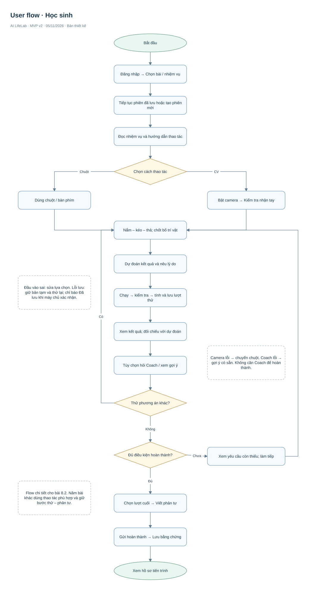
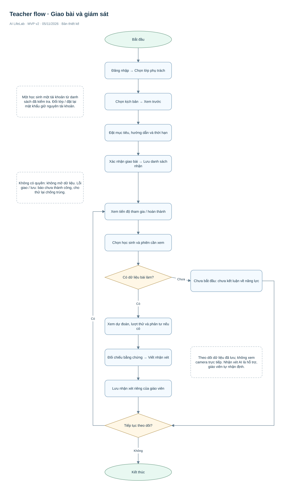
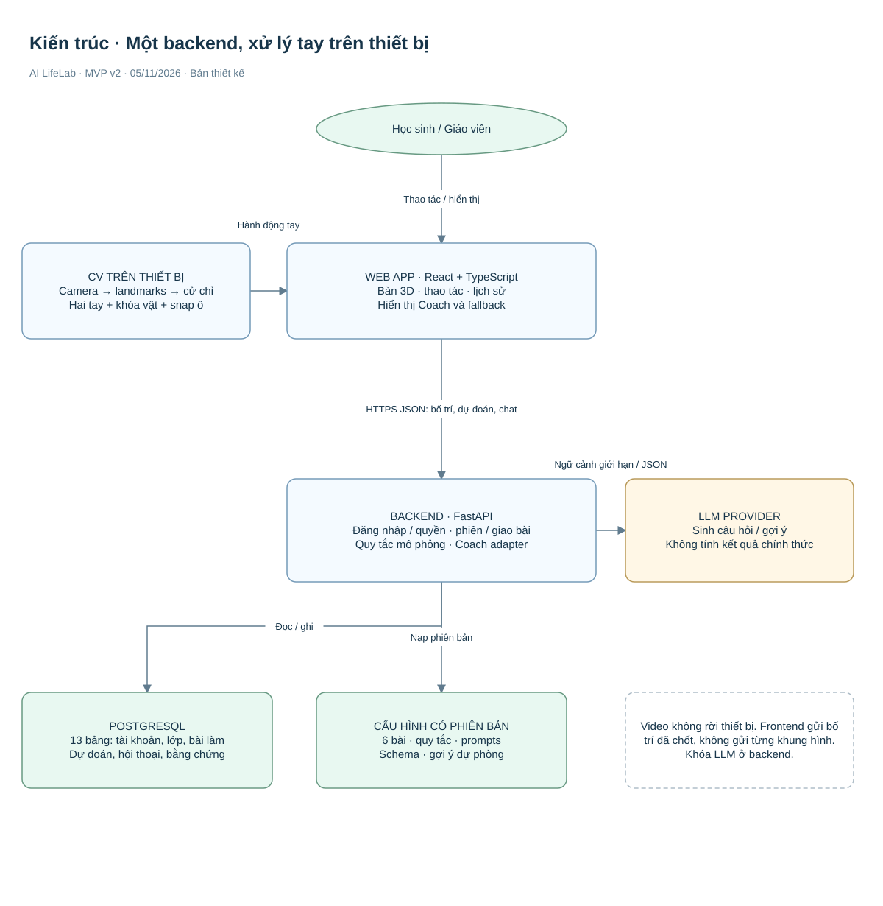
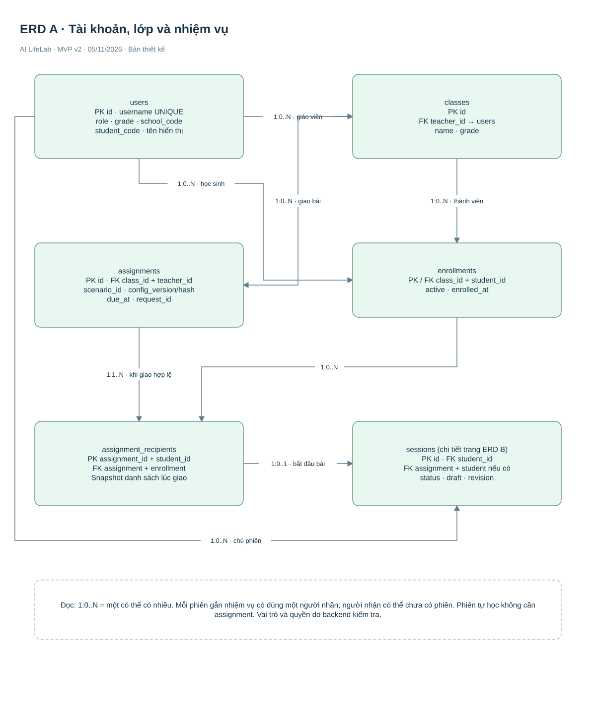
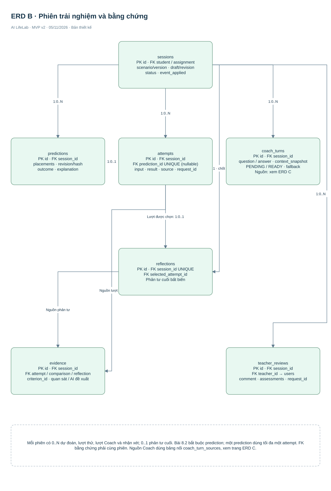
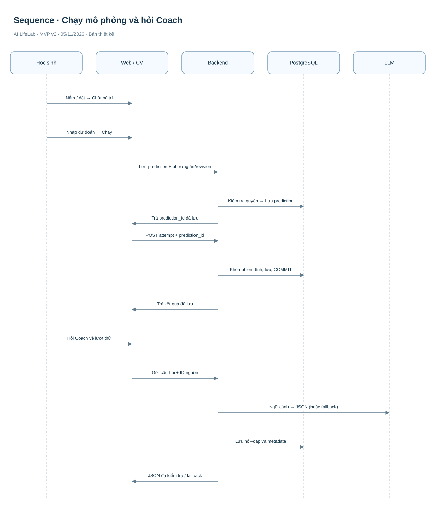
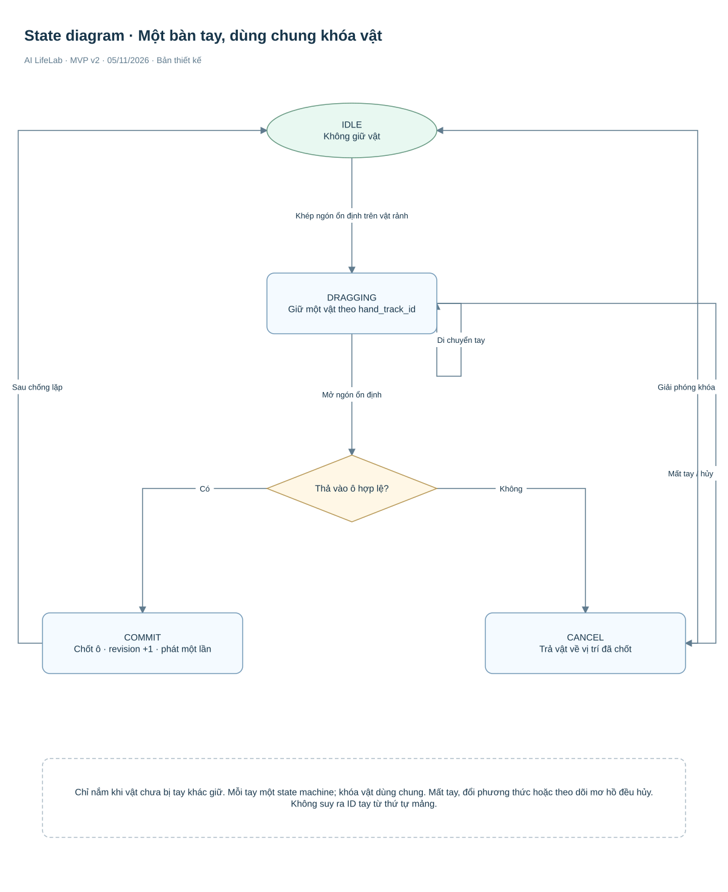
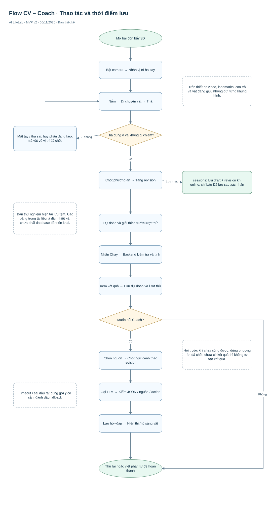
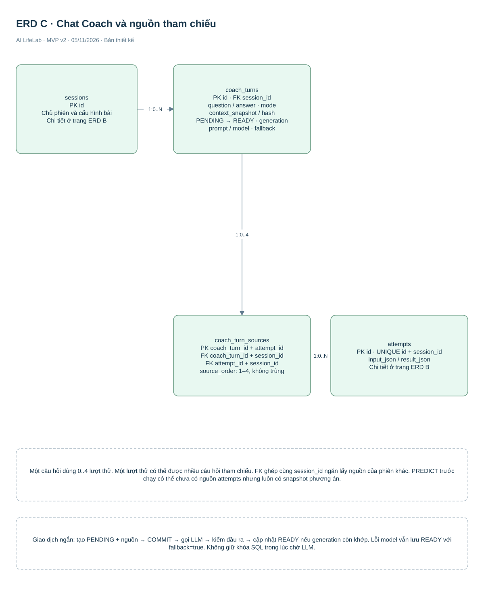

# AI LifeLab — Phân tích và thiết kế MVP v2

**Database chốt toàn project:** [13 bảng, cột và quan hệ để bắt đầu code](database/AI-LifeLab-Database-Toan-du-an.html). SQL chuẩn ở database/schema.sql; schema-v2.sql là bản sao giống hệt. Không dùng bản 7 bảng riêng.

**Ngày:** 05/11/2026. **Trọng tâm:** tương tác tay CV trong bàn thực hành 3D và LLM Coach theo quá trình học.

**Bổ sung mới:** [Flow CV–Chat và dữ liệu database](AI-LifeLab-CV-Chat-Flow-Database.html). Triển khai trước bài đòn bẩy; năm bài còn lại là phạm vi sau. Bản 3D chỉ thay cách thể hiện, vẫn dùng các ô đặt và quy tắc mômen bên dưới; không phải mô phỏng lực chạm thật.

Tài liệu bổ sung có mục 0 đối chiếu video tham khảo và tiêu chí REF-01–05. Video là tham khảo cách trình bày 3D; CV và LLM Coach là phần thiết kế bổ sung của AI LifeLab, chưa có căn cứ xác nhận chúng xuất hiện trong video.

Đây là bản thiết kế mới theo phạm vi đã thống nhất. Chưa phải phần mềm đã triển khai. Các ngưỡng CV và chỉ tiêu kỹ thuật bên dưới là giá trị đề xuất cần thử nghiệm.

**Sơ đồ chỉnh sửa:** [Mở file diagrams.net gồm 9 trang](AI-LifeLab-System-v2.drawio). **Thiết kế dữ liệu:** [schema-v2.sql](schema-v2.sql). **Ví dụ dữ liệu:** [contracts-v2.json](contracts-v2.json).

**Đọc trước:** bản này thay quyết định CV của bản v1: bài 8.2 chuyển từ chọn công trình chứa nước sang cân bằng đòn bẩy. Năm bài còn lại giữ nhiệm vụ cũ. Không dùng cấu hình 8.2 hoặc mẫu CV v1 để triển khai bài mới. Các sơ đồ ERD v2 có 13 bảng; SQL v2 là bản tạo mới, không phải lệnh nâng cấp database đang có.

## 1. Người dùng và mục tiêu

| Người dùng | Nhu cầu | Quyền chính |
|---|---|---|
| Học sinh lớp 8–9 | Thử nghiệm, quan sát kết quả, giải thích lựa chọn | Làm bài được phép; xem dữ liệu của mình; trò chuyện với Coach |
| Giáo viên phụ trách | Giao hoạt động và theo dõi quá trình học | Quản lý lớp được phân công; giao bài; xem bằng chứng; nhận xét |

Mỗi học sinh có một tài khoản, không dùng chung. Danh sách do nhà trường/giáo viên có thẩm quyền cung cấp; người vận hành cấp tài khoản. MVP không xây thêm cổng quản trị hay đăng ký học sinh tự do. Mã học sinh ổn định trong trường, không dùng tên làm định danh. Cặp mã trường + mã học sinh phải duy nhất; đổi lớp, đổi mật khẩu không tạo tài khoản mới. Không cần số căn cước. Cơ sở dữ liệu không tự phát hiện hai mã khác nhau thực ra là một người; danh sách cấp tài khoản phải được kiểm tra.

## 2. Phạm vi chức năng

| Nhóm | Có trong MVP | Chưa triển khai |
|---|---|---|
| Kịch bản | Làm trước 8.2 đòn bẩy; tổng phạm vi dự kiến 6 bài | 5 bài khác triển khai sau; trình tạo bài nâng cao |
| CV | Camera trên máy; tối đa hai tay; nắm, kéo, thả vật vào ô | Nhận vật thể bất kỳ, cảm xúc, khuôn mặt, cảm biến lực |
| Mô phỏng | Bàn đòn bẩy 3D, điểm tựa cố định, vị trí rời rạc | Vật lý động lực học đầy đủ, cảm giác lực và đo độ sâu bàn tay chính xác |
| Coach | Chat văn bản; dự đoán; gợi ý tăng dần; so sánh; phản tư | Giọng nói, tự thay phương án hoặc tự chấm năng lực |
| Học sinh | Lưu nháp, lịch sử lượt thử, phản tư, hồ sơ tiến trình | Mạng xã hội, xếp hạng độ khéo tay |
| Giáo viên | Chọn bài, giao lớp, đặt hạn, theo dõi và nhận xét | Xem camera trực tiếp, sửa bài làm thay học sinh |

| Mã bài | Nội dung v2 |
|---|---|
| 8.1 | Chọn ngưỡng cảnh báo mực nước |
| 8.2 | Cân bằng đòn bẩy 3D bằng CV hoặc chuột/bàn phím |
| 8.3 | Lập kế hoạch tiền tiêu vặt và điều chỉnh khi có phát sinh |
| 9.1 | So sánh điện năng khi thay đổi thời gian dùng thiết bị |
| 9.2 | Lập kế hoạch tiết kiệm và thời gian đạt mục tiêu |
| 9.3 | Lập kế hoạch luyện một kỹ năng |

Giáo viên cần duyệt nội dung, thuật ngữ và mức độ phù hợp lớp học trước khi dùng thử. Mục tiêu là quan hệ khối lượng–khoảng cách–cân bằng; không mặc nhiên khẳng định đây là chuẩn chương trình bắt buộc ở mọi lớp.

## 3. Trải nghiệm chủ đạo và quy tắc mô phỏng

**Chu trình học:** dự đoán → thao tác → chạy → quan sát → trao đổi → thử lại → giải thích.

| Hạng mục | Quy định cho bài 8.2 |
|---|---|
| Vật | Hai vật cố định: A = 1 kg, B = 2 kg; không sửa khối lượng |
| Vị trí | Các ô −4, −3, −2, −1, +1, +2, +3, +4; mỗi đơn vị = 0,1 m; trục dương về bên phải |
| Đặt vật | Mỗi vật một ô, mỗi ô một vật; cần một vật mỗi phía trước khi chạy |
| Trạng thái trước chạy | Học sinh sắp xếp trên thanh nằm ngang; chưa mô phỏng nghiêng khi đang cầm vật |
| Phép tính | g = 9,8 m/s²; T = Σ(m × g × x). T > 0: bên phải hạ; T < 0: bên trái hạ; abs(T) ≤ 0,01 N·m: cân bằng |
| Giả định | Thanh đồng chất, điểm tựa ở tâm nên mômen trọng lượng thanh triệt tiêu; giá đỡ cân bằng lực thẳng đứng; bỏ qua ma sát và biến dạng |
| Hiển thị | Trả hướng nghiêng/cân bằng và mômen từng bên. Chuyển cảnh nghiêng chỉ minh họa, không tuyên bố dự đoán tốc độ/góc quay vật lý |
| Ví dụ cân bằng | A ở −0,4 m; B ở +0,2 m: −3,92 + 3,92 = 0 N·m |
| Ví dụ chưa cân bằng | A ở −0,2 m; B ở +0,2 m: −1,96 + 3,92 = +1,96 N·m; phải hạ |
| Dự đoán | Trước mỗi lượt chạy, chọn trái hạ/phải hạ/cân bằng và giải thích ngắn; lưu kèm phiên bản phương án |
| Hoàn thành | Ít nhất 2 phương án khác nhau đã chạy; có dự đoán gắn với mỗi lượt; chọn lượt cuối và viết phản tư. Không bắt buộc đạt cân bằng mới được hoàn thành |

Mọi kết quả chính thức do backend tính lại. Trình duyệt chỉ gửi ID vật và ô đặt; khối lượng, chi phí hoặc kết quả gửi kèm từ client không được tin cậy.

## 4. CV — tương tác trực tiếp bằng tay

| Bước | Học sinh làm | Hệ thống làm |
|---|---|---|
| Chuẩn bị | Chủ động bật camera và đưa tay vào vùng hướng dẫn | Chỉ xin quyền khi được yêu cầu; hiển thị vùng nhận; tối đa hai tay |
| Chọn | Khép cái–trỏ trên một vật | Hiện vật đang giữ và khóa quyền giữ cho bàn tay đó |
| Di chuyển | Giữ khép ngón và di chuyển tay | Vật theo con trỏ; báo ô hợp lệ gần nhất |
| Thả | Mở ngón trên ô trống | Chốt vị trí vào ô; tăng revision phương án |
| Thử nghiệm | Buông cả hai vật, dự đoán rồi nhấn Chạy | Kiểm tra phương án, gửi backend, lưu lượt thử |
| Phục hồi | Mất tay, đổi phương thức hoặc tắt camera | Hủy vật đang kéo về vị trí đã xác nhận; giữ phương án đã chốt |

Mỗi tay giữ tối đa một vật. Một vật không thuộc hai tay. Gán tay theo ID theo dõi và khoảng cách vị trí giữa các khung hình; không dùng thứ tự phần tử trả về làm danh tính ổn định. Khi hai tay giao nhau hoặc nhận diện mơ hồ, hủy thao tác chưa chốt thay vì chuyển vật sang tay khác.

Ngưỡng thử ban đầu: tỷ lệ khoảng cách cái–trỏ/bề ngang bàn tay < 0,25 trong 3 khung để nắm; > 0,45 trong 3 khung để thả; mất tay ≥ 300 ms để hủy; khoảng chống lặp 400 ms. Tính khoảng cách theo pixel đúng tỷ lệ; quy đổi tọa độ khi video đối xứng. Đây là tham số hiệu chỉnh, không phải chuẩn bảo đảm chính xác.

Camera và landmarks được xử lý trên thiết bị. Không gửi video/landmarks liên tục lên backend hoặc LLM. Chỉ lưu phương án xác nhận và nguồn thao tác. Có chuột/bàn phím với cùng quy tắc; không chấm điểm tốc độ cử chỉ.

**Lợi ích cần kiểm chứng:** phối hợp hai vị trí, thao tác không gian và chủ động khám phá. Không suy ra CV hiệu quả hơn chuột chỉ từ mức độ thích thú.

## 5. LLM Coach nâng cấp

| Chế độ | Đầu vào | Phản hồi |
|---|---|---|
| Dự đoán | Nhiệm vụ, phương án đang chốt | Câu hỏi gợi học sinh dự đoán, không tự điền dự đoán |
| Gợi ý | Câu hỏi và mức gợi ý 1–3 | Quan sát → nhắc quan hệ → gợi một bước kiểm tra |
| Giải thích | Kết quả đã lưu và dữ liệu bài | Giải thích có tham chiếu lượt thử |
| So sánh | Hai lượt khác nhau cùng phiên | Chỉ ra yếu tố thay đổi, yêu cầu học sinh giải thích |
| Phản tư | Lượt cuối, dự đoán và lời giải thích | Gợi bổ sung bằng chứng, không viết thay toàn bộ |

Coach chỉ được gọi khi học sinh yêu cầu hoặc đồng ý mở một gợi ý theo điều kiện xác định trước. Bộ quy tắc có thể hiện nút Gợi ý khi 3 lượt liên tiếp không thay đổi vị trí hoặc cho cùng hướng nghiêng; đây là lời mời, không kết luận học sinh yếu. Không gọi LLM mỗi khung hình.

Ngữ cảnh gửi LLM: mã/phiên bản bài, mục tiêu, câu hỏi, tối đa 4 lượt liên quan, dự đoán, mức gợi ý và tối đa 6 lượt hội thoại gần nhất. Các giới hạn là cấu hình ban đầu; không gửi tên thật, camera hoặc dữ liệu học sinh khác.

Đầu ra JSON gồm message, question, hint_level, referenced_attempt_ids, ui_action. ui_action chỉ được là NONE hoặc HIGHLIGHT_OBJECT với object_id A/B. Frontend chỉ tô sáng, không di chuyển vật hoặc hoàn thành bài. Backend kiểm tra schema, ID nguồn và đối tượng trước khi trả; sai schema/nguồn hoặc quá 10 giây thì dùng gợi ý có sẵn. Đầu vào của học sinh được coi là nội dung không đáng tin, không được thay chỉ dẫn hệ thống. Không suy diễn câu trả lời là đúng chỉ vì JSON hợp lệ; cần bộ tình huống đánh giá nội dung.

Lưu mỗi lượt hỏi–đáp cùng mode, mức gợi ý, source_ids, phiên bản prompt, model, context_hash, fallback và mã yêu cầu. Giao diện phân biệt nhận xét giáo viên và hỗ trợ AI. Hội thoại không tự cập nhật điểm năng lực.

## 6. Yêu cầu và tiêu chí nghiệm thu

| Mã | Yêu cầu | Cách xác nhận đạt |
|---|---|---|
| AC-01 | Một học sinh một tài khoản | Cùng mã trường/mã học sinh không thể được cấp tài khoản thứ hai; đổi lớp vẫn giữ ID |
| AC-02 | Nắm–kéo–thả | Thả ô hợp lệ chốt một lần; sai ô trả về trạng thái trước kéo |
| AC-03 | Hai tay | Không cùng giữ một vật; giao tay không chuyển quyền giữ âm thầm |
| AC-04 | Phục hồi | Mất tay/tắt camera hủy thao tác chưa chốt; chuột tiếp tục được |
| AC-05 | Tính mô phỏng | Hai ví dụ trong mục 3 cho đúng kết quả; đầu vào sai bị từ chối |
| AC-06 | Dự đoán | Chạy chỉ chấp nhận prediction cùng phiên và cùng revision/hash phương án |
| AC-07 | Lưu và thử lại | Gửi lại cùng request_id không tạo thêm lượt; khác payload trả xung đột |
| AC-08 | Coach theo nguồn | So sánh chỉ dùng lượt cùng phiên; đề xuất UI ngoài danh sách bị loại |
| AC-09 | Lỗi AI | Mất kết nối/timeout có fallback; không mất bài và không ngăn hoàn thành |
| AC-10 | Hoàn thành | Chốt phản tư và bằng chứng trong một giao dịch; không chờ LLM |
| AC-11 | Phân quyền | Học sinh không xem phiên người khác; giáo viên không xem lớp ngoài quyền |
| AC-12 | Bảo vệ camera | Kiểm tra network không có ảnh/video/landmarks gửi đến backend hoặc LLM |

## 7. Sơ đồ phân tích và thiết kế

File diagrams.net có 9 trang, mỗi trang giải quyết một câu hỏi. Các đường nối có nhãn; ERD chia ba phần để hạn chế giao cắt. PK là khóa chính; FK là khóa ngoại; 1:0..N nghĩa là một bản ghi có thể liên quan đến không hoặc nhiều bản ghi.

### 7.1. User flow — học sinh

### 7.2. Teacher flow

### 7.3. Kiến trúc hệ thống

### 7.4. ERD — lớp và nhiệm vụ

### 7.5. ERD — quá trình học và Coach

### 7.6. Sequence — một lượt thử và Coach

### 7.7. State diagram — một tay đang thao tác

### 7.8. Flow CV–Coach và thời điểm lưu

### 7.9. ERD — Chat và nguồn tham chiếu

## 8. Dữ liệu và quan hệ

Giữ mô hình 10 bảng v1, bổ sung predictions, coach_turns và coach_turn_sources thành 13 bảng. Dữ liệu 6 bài nằm trong cấu hình có phiên bản, không phải bảng biên soạn bài. SQL chi tiết trong schema-v2.sql; từ điển dữ liệu chuẩn nằm trong tài liệu database toàn dự án.

| Bảng | Một dòng đại diện cho | Quan hệ chính |
|---|---|---|
| users | Một tài khoản | Giáo viên quản lý lớp; học sinh có phiên |
| classes | Một lớp | Thuộc giáo viên; có thành viên và nhiệm vụ |
| enrollments | Một học sinh trong một lớp | PK class_id + student_id; không xóa để thay lịch sử |
| assignments | Một lần giao bài cho lớp | Gắn cấu hình bài/phiên bản và giáo viên |
| assignment_recipients | Một học sinh nhận nhiệm vụ | Chụp danh sách tại lúc giao; có thể chưa có phiên |
| sessions | Một phiên làm bài | Có thể tự học hoặc gắn nhiệm vụ; lưu draft/revision |
| predictions | Một dự đoán trước chạy | Gắn phiên và snapshot phương án; chỉ một lượt thử sử dụng |
| attempts | Một lượt thử đã tính và lưu | Thuộc phiên; bài 8.2 yêu cầu prediction; bất biến |
| reflections | Một phản tư cuối | Tối đa một/phiên; chọn lượt thử cùng phiên |
| evidence | Một tiêu chí có bằng chứng trong phiên | Tham chiếu lượt thử/phản tư, không phải điểm tự động |
| coach_turns | Một cặp hỏi–đáp Coach | Thuộc phiên; chứa nguồn, mode, fallback và metadata |
| coach_turn_sources | Một lượt thử làm nguồn Coach | FK ghép buộc nguồn và câu hỏi cùng phiên |
| teacher_reviews | Một nhận xét của giáo viên | Thuộc phiên; không ghi đè phản tư |

| Ràng buộc | Thực hiện ở đâu |
|---|---|
| Mã trường/mã học sinh duy nhất; PK/FK; request_id chống trùng | PostgreSQL |
| Prediction và attempt phải cùng phiên | FK ghép PostgreSQL |
| Prediction dùng đúng phương án/revision và chưa dùng | Backend giao dịch + unique prediction_id |
| Học sinh đúng khối, giáo viên đúng lớp | Backend kiểm tra quyền mỗi yêu cầu |
| Bài 8.2 bắt buộc prediction, tối thiểu 2 phương án khác nhau | Backend dựa vào cấu hình bài |
| Nguồn Coach đều thuộc cùng phiên | FK ghép trong coach_turn_sources và kiểm quyền backend |
| Một phiên hoàn thành có phản tư hợp lệ và bằng chứng | Backend giao dịch; không dùng CHECK truy vấn bảng khác |

Trường JSON dùng cho cấu trúc khác nhau giữa các bài; không để LLM tự sửa dữ liệu gốc. Hội thoại không lưu khung hình; chưa lưu toàn bộ chuỗi chuyển động tay.

## 9. API và hợp đồng dữ liệu cần cập nhật

Giữ các API tài khoản, lớp, nhiệm vụ, hồ sơ của v1. Bảng dưới là phần v2; không được hiểu OpenAPI v1 đã hỗ trợ toàn bộ thay đổi này.

| Phương thức và đường dẫn | Mục đích | Dữ liệu chính |
|---|---|---|
| GET /api/v1/scenarios/8.2 | Lấy cấu hình đòn bẩy phiên bản mới | Vật, ô đặt, quy tắc, input_schema |
| PATCH /api/v1/sessions/{id}/draft | Lưu bố trí đang làm | revision, placements, reflection_draft |
| POST /api/v1/sessions/{id}/predictions | Lưu dự đoán | request_id, revision, placements, predicted_outcome, explanation |
| POST /api/v1/sessions/{id}/attempts | Chạy và lưu | request_id, prediction_id, placements, source |
| POST /api/v1/sessions/{id}/coach | Hỏi Coach | request_id, mode, question, source_ids, hint_level |
| GET /api/v1/sessions/{id}/coach | Đọc hội thoại đã lưu | Cursor/phân trang |
| POST /api/v1/sessions/{id}/complete | Hoàn thành | request_id, selected_attempt_id, reflection |

API từ chối trường hợp gửi prediction cũ sau khi đổi phương án. Khi lưu draft, revision không khớp trả 409 để tải lại. Yêu cầu có cùng request_id và payload trả kết quả cũ; cùng ID khác payload trả 409. Coach xử lý lặp theo cùng nguyên tắc; có thể lưu fallback nếu provider lỗi, muốn hỏi lại tạo request_id mới. Cấu hình mới dùng scenario_version = balance-v2, rules_version = balance-rules-v1, cv_version và prompt_version riêng.

## 10. Lưu tiến trình, bảo mật và xử lý lỗi

Lưu nháp sau thao tác đã xác nhận theo debounce; chỉ hiện Đã lưu khi nhận phản hồi máy chủ. Khi offline, giữ bản tạm trong bộ nhớ trang, báo rõ chưa đồng bộ. Tắt tab khi chưa lưu có thể mất phần tạm; không hứa khôi phục offline. Hoàn thành cần online và giao dịch nguyên tử. Không ghi phương án chỉ đang kéo thành lượt thử.

Backend kiểm tra người sở hữu phiên và vai trò; cookie HttpOnly, chống CSRF cho yêu cầu thay đổi dữ liệu theo thiết kế v1. Khóa API LLM ở backend. Không đưa thông tin cá nhân hoặc nội dung học sinh khác vào prompt. Giới hạn độ dài chat, số lượt, thời gian chờ và chi phí theo cấu hình. Quy định thời hạn lưu hội thoại và cách xóa dữ liệu cần thống nhất với đơn vị triển khai trước sử dụng thật.

## 11. Kế hoạch triển khai gọn

| Thứ tự | Việc thực hiện | Điều kiện chuyển bước |
|---|---|---|
| 1 | Đòn bẩy chạy bằng chuột; kiểm tra công thức | Các ví dụ và đầu vào sai được kiểm tra |
| 2 | Một tay nắm–kéo–thả, rồi hai tay | Hủy khi mất tay; không nhảy vật hoặc ghi trùng |
| 3 | Database và API lưu dự đoán/lượt thử | Quyền, revision, chống trùng hoạt động |
| 4 | Coach có schema và fallback | Đúng nguồn, không tự thao tác; vượt timeout vẫn học tiếp |
| 5 | Hoàn thành, hồ sơ và giáo viên | Xem được bằng chứng xuyên suốt |
| 6 | Thử với giáo viên và học sinh | Ghi nhận khả dụng, lỗi CV và chất lượng giải thích |

Phải đánh giá riêng: độ ổn định CV, chất lượng Coach và kết quả học tập. So sánh cùng bài bằng tay/chuột với nhiệm vụ tương đương; ghi khả năng dự đoán, giải thích và vận dụng, không chỉ sự thích thú. Chưa có kết quả thử nghiệm để khẳng định tăng hiệu quả.

## 12. Bộ file và trạng thái xác minh

| File | Mục đích |
|---|---|
| AI-LifeLab-Phan-tich-Thiet-ke-v2.html | Tài liệu đọc chính |
| AI-LifeLab-System-v2.drawio | 9 trang sơ đồ chỉnh sửa trong diagrams.net |
| AI-LifeLab-CV-Chat-Flow-Database.html | Giải thích thao tác 3D, flow, từ điển dữ liệu và ví dụ lưu |
| diagrams/*.svg | Bản xem trước từng trang |
| schema-v2.sql | DDL tạo mới 13 bảng; đã kiểm bằng PostgreSQL bộ nhớ, chưa chạy server |
| contracts-v2.json | Ví dụ đầu vào/đầu ra đòn bẩy và Coach |
| coach-prompt-v2.md | Prompt Coach, kiểm tra đầu ra và fallback |
| README.md | Cách mở và phạm vi thay đổi |
| validation-report.json | Kiểm tra cấu trúc file, liên kết và ví dụ số |
| visual-report.json | Kiểm tra hiển thị HTML/SVG; không thay thế mở file bằng diagrams.net |

Sơ đồ mô tả hệ thống dự kiến. Kiểm tra file và phép tính không chứng minh camera, API, model hoặc PostgreSQL đã hoạt động. Chưa chạy thử CV hai tay, gọi LLM thật, tạo database hoặc đánh giá với học sinh.

## 13. Căn cứ tham khảo

Nguyên lý cân bằng dựa trên điều kiện tổng mômen bằng không trong [OpenStax — The Second Condition for Equilibrium](https://openstax.org/books/college-physics/pages/9-2-the-second-condition-for-equilibrium). Các khối lượng, ô đặt và giới hạn trong bài là tham số giáo dục tự thiết kế, cần giáo viên duyệt.

Hướng kỹ thuật nhận landmarks bàn tay tham khảo [Google — Hand Landmarker for Web](https://developers.google.com/edge/mediapipe/solutions/vision/hand_landmarker/web_js). Nhận landmarks và xử lý nắm/thả là hai tầng khác nhau; chất lượng thao tác hai tay của dự án chưa được xác minh.
