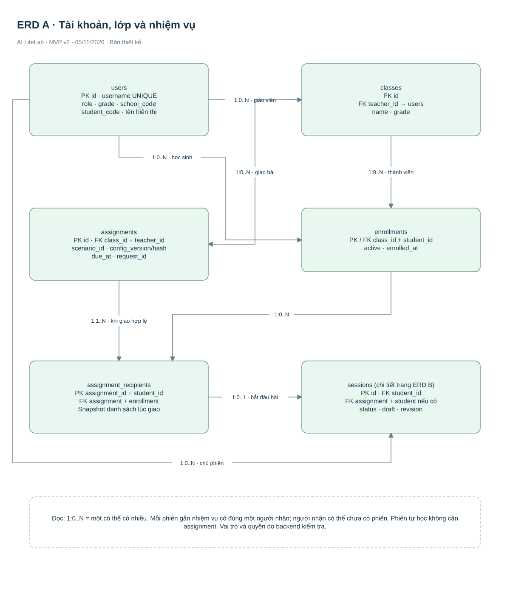
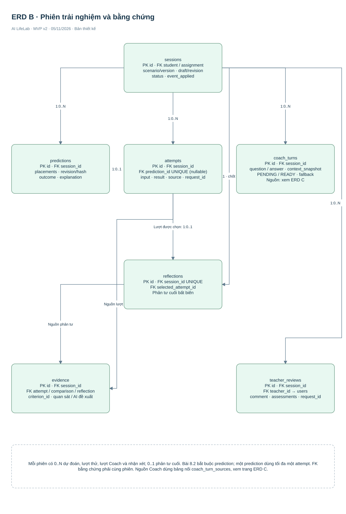
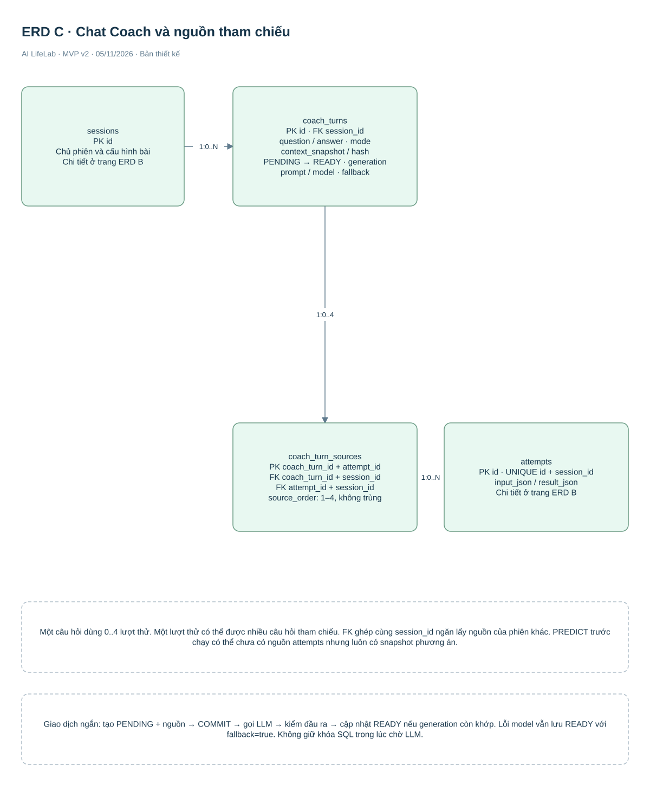

# AI LifeLab — Thiết kế database toàn dự án

**Bản chốt để bắt đầu viết code — 05/11/2026. Phạm vi: toàn bộ ứng dụng, 13 bảng.** Bài đòn bẩy CV/Coach được triển khai trước nhưng cấu trúc này bao phủ cả tài khoản, lớp học, giao bài, 6 kịch bản, tiến trình, phản tư và nhận xét giáo viên.

[SQL tạo database](schema.sql) · [ERD riêng gồm 3 trang](ERD-Database.drawio) · [Báo cáo kiểm tra database](database-validation.json) · [Tài liệu hệ thống](../AI-LifeLab-Phan-tich-Thiet-ke-v2.html).

[Truy vấn mẫu cho API](queries.sql) gồm bài được giao, lịch sử lượt thử, hội thoại và tiến độ nhiệm vụ. Tham số người dùng phải được lấy từ tài khoản đã xác thực.

**Dùng bản này khi code.** Bản 7 bảng lõi đang phác thảo đã được bỏ sau khi chốt lại phạm vi toàn dự án. Bản 12 bảng trước được cập nhật thành 13 bảng: thêm coach_turn_sources để database tự kiểm tra nguồn Chat thuộc đúng phiên, thay cho danh sách ID nằm riêng trong JSON. schema-v2.sql ở thư mục cha là bản sao giống schema.sql, không phải database thứ hai.

## 1. Những quyết định đã chốt

| Nội dung | Quyết định |
|---|---|
| Công nghệ | PostgreSQL; UUID do backend tạo; thời gian dùng timestamptz và trao đổi dạng ISO 8601 |
| Tài khoản | Một học sinh một tài khoản; UNIQUE mã trường + mã học sinh; đổi lớp không đổi tài khoản |
| Lớp | Một giáo viên phụ trách mỗi lớp trong MVP; học sinh có thể có lịch sử nhiều lớp |
| Giao bài | Mỗi lần giao là một assignment; lưu danh sách học sinh nhận ngay lúc giao |
| Phiên | Một phiên cho một học sinh + một bài. Bài được giao tối đa một phiên mỗi người nhận; tự học có thể làm lại sau khi hoàn thành |
| Kịch bản | 6 cấu hình có phiên bản nằm cùng mã nguồn; database giữ snapshot + hash của cấu hình đã dùng |
| CV | Lưu bố trí đã xác nhận, nguồn thao tác và phiên bản CV; không lưu video, landmarks hoặc từng khung hình |
| Chat | Một coach_turn là một cặp hỏi–đáp; nguồn lượt thử được lưu bằng bảng nối có FK cùng phiên |
| Hồ sơ | Tổng hợp từ sessions, attempts, evidence và teacher_reviews; không tạo bảng sao chép tiến độ |
| Nội dung công khai | Trang chủ, hướng dẫn và giới thiệu dùng nội dung tĩnh; chưa cần CMS hoặc bảng riêng |
| Ngoài phạm vi | Nhiều trường có quản trị riêng, nhiều giáo viên đồng quản lý lớp, công cụ biên soạn bài, phân quyền phức tạp |

Không dùng tên học sinh để chống trùng tài khoản. Chuẩn hóa mã trường/mã học sinh trước khi ghi. Học sinh không tự tạo tài khoản lần hai; người cấp tài khoản phải đối chiếu danh sách gốc. UNIQUE không tự phát hiện cùng một người bị cấp hai mã khác nhau.

## 2. Tổng quan 13 bảng

| Nhóm | Bảng | Một dòng đại diện cho |
|---|---|---|
| Người dùng | users | Một tài khoản học sinh hoặc giáo viên |
| Lớp | classes | Một lớp do một giáo viên phụ trách |
| Thành viên | enrollments | Một học sinh thuộc một lớp |
| Giao bài | assignments | Một lần giao kịch bản cho lớp |
| Người nhận | assignment_recipients | Một học sinh nhận một nhiệm vụ |
| Trải nghiệm | sessions | Một phiên thực hiện một bài |
| Dự đoán | predictions | Một dự đoán gắn với phương án trước khi chạy đòn bẩy |
| Thử nghiệm | attempts | Một lượt chạy mô phỏng đã xác nhận |
| Hỗ trợ | coach_turns | Một câu hỏi và phản hồi Coach hoặc fallback |
| Nguồn Chat | coach_turn_sources | Một lượt thử được một câu hỏi Coach tham chiếu |
| Phản tư | reflections | Một lời giải thích cuối của phiên |
| Bằng chứng | evidence | Một tiêu chí được ghi nhận với nguồn cụ thể |
| Giáo viên | teacher_reviews | Một nhận xét của giáo viên về phiên |

PK là khóa chính, mã xác định một dòng. FK là khóa ngoại, mã trỏ đến dòng ở bảng khác. NULL nghĩa là chưa có hoặc không áp dụng. Các bảng dưới ghi toàn bộ trường theo nhóm để dễ đọc; kiểu và ràng buộc đầy đủ nằm trong SQL.

## 3. Người dùng và lớp học

### users — tài khoản

| Trường | Kiểu / điều kiện | Dùng để làm gì? |
|---|---|---|
| id | UUID, PK | Định danh tài khoản |
| username | varchar(50), duy nhất, chữ thường a–z/số/._- | Đăng nhập; backend chuẩn hóa trước khi gửi |
| password_hash | text, bắt buộc | Mật khẩu đã băm bằng thư viện Argon2id; không lưu mật khẩu gốc |
| display_name | varchar(100), không rỗng | Tên hiển thị |
| role | STUDENT hoặc TEACHER | Phân biệt quyền |
| school_code, student_code | Mã trường và học sinh; cặp duy nhất | Một tài khoản cho mỗi học sinh; học sinh bắt buộc có cả hai |
| grade | 8 hoặc 9 với học sinh; NULL với giáo viên | Khối hiện tại |
| learning_goal | EV-01/02/03 hoặc NULL | Mục tiêu cá nhân tùy chọn |
| auth_epoch | integer, mặc định 0 | Tăng để vô hiệu hóa các token đăng nhập cũ khi cần |
| active, created_at | boolean, thời gian | Khóa tài khoản và ngày tạo |

### classes và enrollments — lớp và thành viên

| Bảng | Trường | Ý nghĩa |
|---|---|---|
| classes | id PK; teacher_id FK users | Mã lớp và giáo viên phụ trách |
| classes | name; grade; created_at | Tên, khối, thời điểm tạo |
| enrollments | class_id FK; student_id FK | PK ghép: một học sinh không trùng hai dòng trong cùng lớp |
| enrollments | active; enrolled_at | Có đang thuộc lớp và thời điểm tham gia |

Quan hệ học sinh–lớp là nhiều–nhiều qua enrollments. Khi chuyển lớp, đánh active=false ở lớp cũ và thêm thành viên lớp mới, không xóa dòng cũ. Trong MVP không đổi teacher_id của một lớp đã có nhiệm vụ; khi thay phụ trách theo đợt học mới, tạo lớp mới để giữ lịch sử giao bài.

## 4. Giao nhiệm vụ

### assignments — lần giao bài

| Nhóm trường | Trường chính xác | Ý nghĩa |
|---|---|---|
| Định danh | id PK; class_id; teacher_id | FK ghép bảo đảm giáo viên đúng lớp |
| Chống gửi trùng | client_request_id; request_hash | Gửi lại cùng ID không tạo nhiệm vụ mới |
| Bài học | scenario_id; content_version; rules_version; dataset_version | Mã bài và các phiên bản nội dung/quy tắc/dữ liệu |
| Bản chụp cấu hình | config_snapshot JSONB; config_hash | Giữ đúng cấu hình lúc giao dù mã nguồn thay đổi |
| Giao việc | instructions; objectives; rubric_json | Hướng dẫn, mục tiêu và tiêu chí giáo viên điều chỉnh trong giới hạn cấu hình |
| Thời gian | due_at; created_at | Hạn và lúc giao; phiên bản đầu vẫn cho nộp muộn, hiển thị trễ hạn |

### assignment_recipients — danh sách nhận bài

| Trường | Ý nghĩa |
|---|---|
| assignment_id + student_id | PK ghép; một học sinh nhận một lần |
| class_id | FK ghép tới assignment và enrollment để người nhận đúng lớp |
| assigned_at | Lúc ghi nhận người nhận |

Giao nhiệm vụ và tạo toàn bộ recipients trong một giao dịch. Chỉ lấy enrollments đang active tại thời điểm giao. Học sinh mới vào lớp không tự xuất hiện trong nhiệm vụ cũ; chuyển lớp cũng không làm mất lịch sử đã nhận.

## 5. Phiên, dự đoán và lượt thử

### sessions — tiến trình của một bài

| Nhóm trường | Trường chính xác | Ý nghĩa |
|---|---|---|
| Định danh | id PK; student_id FK | Ai đang thực hiện |
| Nguồn bài | assignment_id hoặc NULL | Được giao hay tự học; FK ghép với student_id bảo đảm đúng người nhận |
| Chống gửi trùng | client_request_id; start_request_hash | Không tạo phiên hai lần khi mạng gửi lại |
| Nội dung | scenario_id; content_version; rules_version; dataset_version; config_snapshot; config_hash | Chốt phiên bản và cấu hình đã dùng; nếu từ bài giao phải khớp assignment |
| Trạng thái | status | IN_PROGRESS, REFLECTION hoặc COMPLETED |
| Lưu nháp | draft_json; draft_revision; saved_at | Bố trí/lựa chọn đã chốt, phản tư nháp, số lần thay đổi và thời điểm lưu |
| Lượt thử | next_attempt_number | Cấp số thứ tự trong giao dịch khóa phiên |
| Biến cố | event_applied; event_applied_at | Một biến cố cho bài 8.3/9.2; các bài khác không dùng |
| Hoàn thành | complete_request_id; completion_request_hash; completed_at | Chống hoàn thành trùng và ghi thời điểm |
| Ngày tạo | created_at | Bắt đầu phiên |

Chỉ một phiên cho mỗi assignment + học sinh. Tự học chỉ một phiên chưa hoàn thành cho mỗi học sinh + scenario; hoàn thành xong được tạo phiên mới. draft_json phải được kiểm schema theo bài. Khi lưu, backend yêu cầu revision đang đọc khớp revision hiện tại; nếu không, trả xung đột để tải lại.

### predictions — dự đoán bài đòn bẩy

| Trường | Ý nghĩa |
|---|---|
| id PK; session_id FK | Dự đoán thuộc phiên nào |
| client_request_id; request_hash | Chống lưu trùng |
| draft_revision; placements_json; plan_hash | Đúng phương án đã dự đoán; A/B và ô đặt được kiểm theo cấu hình |
| predicted_outcome | LEFT_DOWN, RIGHT_DOWN hoặc BALANCED |
| explanation; created_at | Lý do và thời điểm, trước lượt thử |

predictions dành cho bài 8.2 hiện tại. Các bài khác vẫn có Chat PREDICT nếu phù hợp nhưng chưa bắt buộc ghi một dự đoán dạng hướng nghiêng. Không dùng predicted_outcome này cho bài tài chính.

### attempts — mỗi lần chạy

| Trường | Ý nghĩa |
|---|---|
| id PK; session_id FK | Lượt thử thuộc phiên |
| prediction_id FK, nullable, duy nhất | Bài 8.2 bắt buộc; bài khác có thể NULL. FK ghép bảo đảm cùng phiên |
| client_request_id; request_hash | Gửi lại cùng yêu cầu trả kết quả đã có |
| attempt_number | Tăng trong phiên, không trùng |
| source | pointer, keyboard hoặc gesture |
| cv_version | Bắt buộc nếu source=gesture; không lưu hand_track_id |
| phase | BASELINE hoặc AFTER_EVENT; backend suy ra, không tin client |
| input_json | Lựa chọn đã xác nhận: bố trí vật hoặc kế hoạch theo bài |
| result_json | Kết quả backend tính từ cấu hình phiên |
| created_at | Thời điểm chạy và lưu |

predictions và attempts là bản ghi chốt, không sửa/xóa trong luồng học thông thường. Thay phương án tạo lượt mới. Backend bắt buộc kiểm prediction khớp revision + bố trí, và kết quả đúng quy tắc; FK không tự tính toán mô phỏng.

## 6. Chat Coach và nguồn tham chiếu

### coach_turns — một cặp hỏi–đáp

| Nhóm | Trường | Ý nghĩa |
|---|---|---|
| Định danh | id PK; session_id FK; client_request_id; request_hash | Câu hỏi thuộc đúng phiên, chống gửi trùng |
| Yêu cầu | mode; hint_level; question | PREDICT/HINT/EXPLAIN/COMPARE/REFLECT; mức 1–3; nội dung hỏi |
| Vật đang hỏi | focused_object_id | A/B trong bài đòn bẩy hoặc NULL; bài khác không dùng các ID này |
| Ngữ cảnh | context_snapshot; context_hash; prompt_version | Phương án, revision và dữ liệu cần thiết lúc hỏi; phiên bản chỉ dẫn |
| Trạng thái | status; generation; lease_until | PENDING đang xử lý, READY đã có câu trả lời; số lần nhận xử lý và hạn giữ quyền xử lý |
| Phản hồi | answer; followup_question | Giải thích và câu hỏi dẫn dắt |
| Hành động giao diện | ui_action; highlight_object_id | NONE hoặc HIGHLIGHT_OBJECT A/B; chỉ tô sáng, không sửa bài |
| Nguồn trả lời | model_id; fallback; fallback_reason | Có dùng LLM hay gợi ý sẵn; ghi lý do fallback |
| Thời gian | created_at; finished_at | Bắt đầu và kết thúc xử lý |

Trước khi có lượt thử, Coach có thể dùng snapshot phương án và không có nguồn attempts. Không gửi tên thật hoặc video vào context_snapshot. Cho bài khác, focused_object_id và highlight_object_id phải NULL, ui_action=NONE trong MVP.

### coach_turn_sources — bảng nối nguồn Chat

| Trường | Ý nghĩa |
|---|---|
| coach_turn_id + attempt_id | PK ghép; không tham chiếu trùng một lượt |
| session_id | Hai FK ghép buộc Coach và lượt thử cùng phiên |
| source_order | 1–4; duy nhất trong một câu hỏi, tối đa 4 nguồn |

Một câu hỏi dùng nhiều lượt thử; một lượt thử được nhiều câu hỏi dùng. Vì vậy đây là quan hệ nhiều–nhiều, cần bảng nối. source_ids trong API được chuyển thành các dòng ở đây, không lưu thêm một mảng ID độc lập có thể lệch với bảng.

COMPARE cần đúng hai nguồn khác nhau, kiểm ở backend. Chỉ thêm nguồn khi Coach còn PENDING. READY thì khóa nội dung và nguồn; muốn hỏi lại tạo lượt mới.

**Tránh gọi AI khi đang giữ giao dịch SQL:** tạo PENDING và nguồn rồi COMMIT → gọi LLM → kiểm JSON và nguồn → cập nhật READY trong giao dịch ngắn. Nếu lỗi, vẫn chuyển READY với fallback=true. Nếu backend chết lúc PENDING, yêu cầu gửi lại có thể nhận xử lý khi lease hết hạn và tăng generation; kết quả chỉ được ghi nếu generation còn khớp. Đây là khóa xử lý một yêu cầu, không cần hệ thống hàng đợi riêng.

## 7. Phản tư, bằng chứng và giáo viên

| Bảng | Trường | Ý nghĩa |
|---|---|---|
| reflections | id PK; session_id UNIQUE; selected_attempt_id; answer; created_at | Tối đa một phản tư cuối; lượt được chọn phải cùng phiên |
| evidence | id PK; session_id; criterion_id | Tối đa một bằng chứng cho mỗi EV-01/02/03 trong phiên |
| evidence | attempt_id; comparison_attempt_id; reflection_id | FK ghép cùng phiên; lượt so sánh nếu có phải khác lượt chính |
| evidence | observation_json | Quan sát từ bài làm, không phải kết luận năng lực |
| evidence | ai_assessment; feedback_context_hash; prompt_version; model_id; ai_created_at; created_at | Đề xuất hỗ trợ tùy chọn của AI và nguồn tạo |
| teacher_reviews | id PK; session_id FK; teacher_id FK; client_request_id; request_hash | Người nhận xét và chống ghi trùng |
| teacher_reviews | comment; assessments_json; created_at | Nhận xét và đánh giá của giáo viên, tách khỏi lời học sinh |

EV-01: dùng dữ liệu để giải thích; EV-02: xem xét lựa chọn/đánh đổi; EV-03: điều chỉnh có lý do. Chỉ ghi khi có nguồn tương ứng; không bắt buộc tạo đủ ba dòng và không tự biến chúng thành điểm năng lực. Mọi bộ tiêu chí phải được giáo viên duyệt theo kịch bản.

## 8. ERD và quan hệ

| Quan hệ | Số lượng | Vì sao? |
|---|---|---|
| users → classes | 1 → 0..N | Một giáo viên có thể quản lý nhiều lớp |
| users ↔ classes | N ↔ N qua enrollments | Học sinh có lịch sử tham gia lớp |
| classes → assignments | 1 → 0..N | Lớp nhận nhiều nhiệm vụ |
| assignments → assignment_recipients | 1 → N khi giao hợp lệ | Một danh sách nhận được chụp lúc giao |
| assignment_recipients → sessions | 1 → 0..1 | Chưa bắt đầu hoặc đã có một phiên |
| users → sessions | 1 → 0..N | Một học sinh có nhiều phiên |
| sessions → predictions / attempts / coach_turns | 1 → 0..N | Nhiều dự đoán, lượt thử và câu hỏi |
| predictions → attempts | 1 → 0..1 | Dự đoán chưa chạy hoặc dùng một lần |
| coach_turns ↔ attempts | N ↔ N qua coach_turn_sources | Câu hỏi dùng các lượt làm căn cứ |
| sessions → reflections | 1 → 0..1 | Chưa phản tư hoặc có bản cuối |
| sessions → evidence / teacher_reviews | 1 → 0..N | Nhiều tiêu chí và nhận xét |

ERD chia trang để đọc rõ. Quan hệ tới student_id, teacher_id và FK ghép đầy đủ xem SQL; không suy rằng mọi FK đã vẽ đủ trên một trang.

## 9. Quy tắc cần thực hiện trong backend

| Luồng | Kiểm tra và ghi trong một giao dịch |
|---|---|
| Cấp tài khoản | Chuẩn hóa mã; kiểm danh sách gốc; băm mật khẩu; không tạo mới khi chỉ đổi lớp |
| Giao bài | Giáo viên có quyền lớp; cấu hình hợp lệ; lưu assignment và toàn bộ recipients active |
| Bắt đầu / tiếp tục | Đúng người nhận; đúng cấu hình; tìm lại phiên đã có trước khi tạo |
| Lưu nháp | Đúng chủ phiên, chưa hoàn thành; so revision; kiểm schema; tăng revision sau khi lưu |
| Chạy | Khóa session; kiểm quyền và phase; kiểm prediction nếu 8.2; tính lại kết quả; cấp attempt_number; lưu; COMMIT |
| Coach | Chốt snapshot từ nguồn máy chủ; kiểm ID cùng phiên; tạo PENDING và nguồn; gọi LLM ngoài giao dịch; cập nhật có kiểm generation |
| Hoàn thành | Đủ điều kiện riêng từng bài; chọn lượt cùng phiên; chốt reflection + evidence + COMPLETED trong một giao dịch |
| Giáo viên nhận xét | Có quyền lớp của assignment; không tự mở mọi phiên tự học; thêm teacher_review, không ghi đè bài học sinh |

Khi gửi lại cùng client_request_id: so request_hash, giống thì trả kết quả cũ; khác trả 409. Database chặn trùng ID, còn backend phải thực hiện việc so hash và trả đúng phản hồi.

Mỗi SQL truy vấn từ API phải giới hạn theo người dùng được xác thực. UUID khó đoán không phải cơ chế phân quyền. Các ràng buộc số lượng nguồn COMPARE, grade/role, hash cấu hình, điều kiện hoàn thành và đánh giá bằng chứng không được hiểu là đã được database tự kiểm toàn bộ.

## 10. Những dữ liệu không tạo bảng riêng

Không tạo bảng cho khung hình camera, landmarks, bàn tay ảo, menu đang mở, góc nhìn hoặc vật đang kéo. CV chỉ gửi bố trí đã chốt. Không tạo bảng profile_progress để lưu lại số bài hoàn thành, vì có thể truy vấn từ sessions. Không tạo bảng scenarios/CMS khi kịch bản còn được giữ trong các file cấu hình có phiên bản; nếu thêm trình biên soạn sau này mới thiết kế phần đó.

Giữ một bản tài khoản khi chuyển lớp. Không xóa enrollment hoặc recipient để thay tiến độ. Các bản ghi học tập đã chốt là bất biến trong luồng thông thường; chính sách xóa dữ liệu theo yêu cầu cần quy trình quản trị riêng trước triển khai thật.

## 11. Bắt đầu code theo thứ tự

Tạo schema trong database trống bằng schema.sql. Không chạy như migration trên schema cũ. Không có lệnh DROP. Sau đó làm lần lượt users → classes/enrollments → assignments/recipients → sessions → predictions/attempts → Coach → reflections/evidence/reviews. Với lát cắt đòn bẩy có thể dùng tài khoản thử được cấp sẵn và tự học trước, các quan hệ lớp không cản trở vì assignment_id cho phép NULL.

API source dùng thống nhất pointer/keyboard/gesture; giá trị mouse của tài liệu v1 cần chuyển sang pointer. API vẫn có thể trả result và source_ids dạng JSON, backend ánh xạ từ result_json và bảng nối. Không gửi password_hash cho frontend.

## 12. Xác minh và giới hạn

Đã thực thi DDL và các tình huống PK/FK/UNIQUE/CHECK/trigger trên PostgreSQL chạy trong bộ nhớ bằng PGlite; xem database-validation.json để biết số kiểm tra và engine. Đây không phải một PostgreSQL server đã triển khai. Chưa kiểm thử đồng thời nhiều kết nối, phân quyền backend, camera hoặc LLM thật.

Đối chiếu nguyên tắc ràng buộc tại [PostgreSQL — Constraints](https://www.postgresql.org/docs/current/ddl-constraints.html). Môi trường kiểm tra theo [PGlite — API](https://pglite.dev/docs/api). Không dùng CHECK có truy vấn sang bảng khác; dùng FK/UNIQUE khi phù hợp, các luật nghiệp vụ còn lại đặt trong giao dịch backend.
