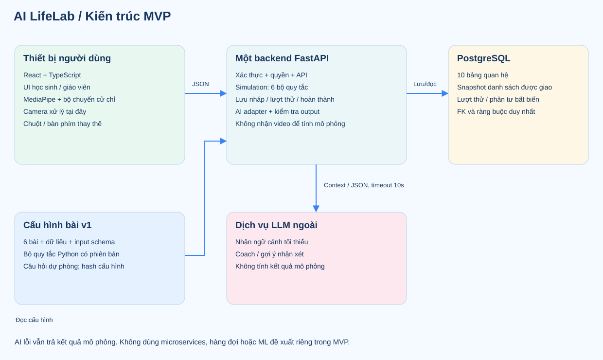
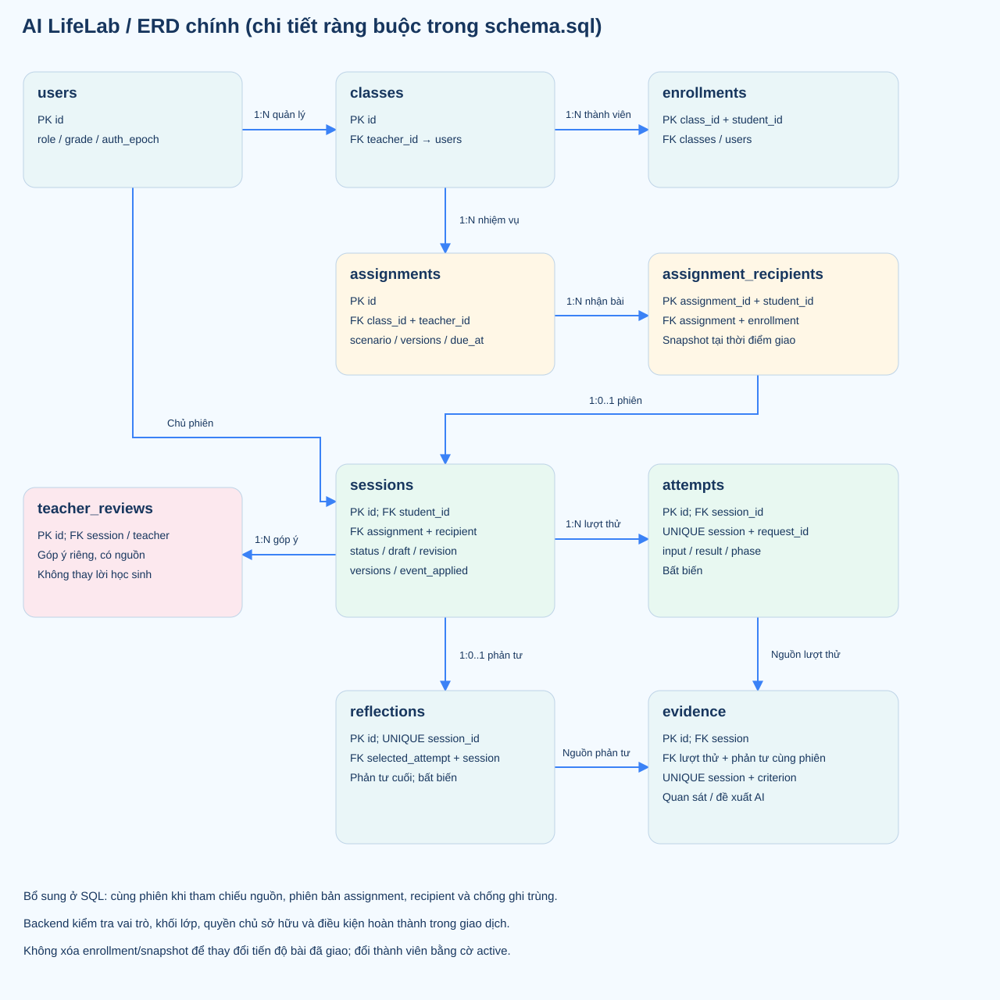
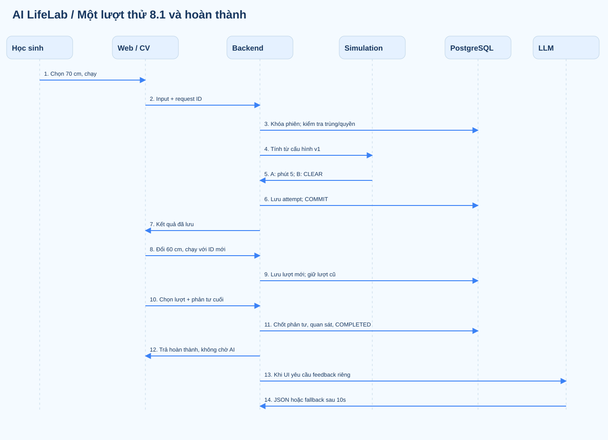

# AI LifeLab — Thiết kế CV, AI và hệ thống MVP

**Ngày:** 28/10/2026. **Phiên bản thiết kế:** 1.0.  
**Căn cứ nghiệp vụ:** [Đặc tả 6 nhiệm vụ](AI-LifeLab-Dac-ta-MVP.html).  
**Yêu cầu cần đáp ứng:** [Mục 3 và 5 — Yêu cầu, bằng chứng học tập](AI-LifeLab-Yeu-cau-Bang-chung-Huong-dan.html).

Tài liệu này thực hiện phần thiết kế của **bước 4 và 6**, thay cho việc chỉ hướng dẫn. Đã có cấu hình 6 bài, hợp đồng dữ liệu, API, DDL cơ sở dữ liệu, sơ đồ và mẫu thử CV. Chưa phải ứng dụng đã triển khai; trạng thái xác minh được ghi cuối tài liệu.

**Tải toàn bộ:** [Gói thiết kế bước 4 và 6](AI-LifeLab-Thiet-ke-4-6.zip).

## 1. Các quyết định thiết kế đã chốt

| Nội dung | Quyết định cho MVP |
|---|---|
| Frontend | React + TypeScript; một ứng dụng cho hai vai trò; dùng lại component, form và lớp gọi API |
| Backend | FastAPI/Python; một backend, các module nội bộ rõ trách nhiệm |
| Cơ sở dữ liệu | PostgreSQL; dữ liệu quan hệ và JSON cho đầu vào/kết quả khác nhau giữa 6 bài |
| Tính mô phỏng | Backend tính từ dữ liệu có phiên bản, không dùng LLM làm máy tính |
| CV | MediaPipe Hand Landmarker trên thiết bị; chỉ thao tác chọn/thả trong bài 8.2; có chuột/bàn phím thay thế |
| AI | Một adapter LLM với hai tác vụ: Coach và đề xuất nhận xét phản tư. Model/provider là cấu hình backend, không ảnh hưởng hợp đồng đầu ra |
| Dữ liệu bài | Một bộ cấu hình v1 cho 6 nhiệm vụ, giữ cùng mã nguồn; không làm trình biên soạn kịch bản |
| Lưu trữ | 10 bảng, không lưu video. Thêm assignment_recipients so với gợi ý 9 bảng ban đầu để giữ danh sách nhận bài đúng thời điểm giao |
| Đồng bộ | Lưu nháp có revision; chạy và hoàn thành có mã yêu cầu chống ghi trùng |
| Ngoài phạm vi | Microservices, Redis, hàng đợi riêng, ML phân cụm, đề xuất bằng ML, CV cho toàn bộ bài, tạo kịch bản tự động |

Đây là lựa chọn kỹ thuật cho bản thiết kế, không khẳng định nhóm đã cài hoặc chạy các hệ thống này. Phiên bản thư viện triển khai cần được khóa trong dự án sau thử nghiệm; các hợp đồng nội dung/API hiện được khóa ở v1.

## 2. Bước 4 — Thiết kế CV và AI

### 2.1. Ranh giới trách nhiệm

| Thành phần | Đầu vào | Đầu ra | Quyền hạn |
|---|---|---|---|
| Bộ CV | Khung hình camera trên thiết bị | Vị trí điểm tay và cử chỉ đã xác nhận | Chỉ tạo hành động lựa chọn; không quyết định đúng/sai của nhiệm vụ |
| Bộ chuyển thao tác | Chọn/thả từ CV hoặc chuột | facility_id, slot_id, source | Dùng một quy tắc chọn ô; kiểm tra trùng và ngân sách trên giao diện để phản hồi nhanh |
| Simulation Engine | Input tường minh và cấu hình phiên bản từ session | Kết quả số/trạng thái, hoặc lỗi đầu vào | Backend là nơi tính và kiểm tra cuối; không tin chi phí/kết quả gửi từ frontend |
| AI Coach | Nhiệm vụ, kết quả các lượt được phép và mức gợi ý | Một câu hỏi, một gợi ý, ID nguồn | Không sửa dữ liệu gốc, không chọn hộ đáp án để được hoàn thành |
| AI đọc phản tư | Phản tư cuối và dữ liệu nguồn | Đề xuất EV-01/02/03 kèm ID | Là nhận xét hỗ trợ, cần giáo viên xem lại, không phải điểm năng lực |

### 2.2. Cử chỉ duy nhất của MVP

**Bài áp dụng:** 8.2 — Thu và lưu nước mưa. Chọn công trình ở vùng trên, đưa con trỏ ảo xuống đúng ô và mở ngón để thả. Bồn → A; bể → B; hồ → C.

| Tham số của mẫu thử | Giá trị khởi đầu | Ý nghĩa |
|---|---|---|
| Số tay | 1 | Giảm mơ hồ khi chọn đối tượng |
| Con trỏ | Đầu ngón trỏ, landmark 8 | Chuyển tọa độ thành vị trí trên bảng thao tác |
| Chọn | Khoảng cách ngón cái–trỏ / bề ngang bàn tay < 0,25 trong 3 khung hình | Khép hai ngón; giá trị cần hiệu chỉnh, không phải ngưỡng chuẩn MediaPipe |
| Thả | Tỷ lệ trên > 0,45 trong 3 khung hình | Có khoảng đệm để hạn chế rung giữa chọn và thả |
| Mất tay | 300 ms liên tục | Hủy thao tác chưa xác nhận, giữ lựa chọn đã áp dụng |
| Khoảng cách hai lần phát hành động | Tối thiểu 400 ms | Hạn chế phát lặp |
| Tần suất xử lý PoC | Tối đa khoảng 12 lần/giây | Chưa phải số đo hiệu năng; mẫu thử giới hạn tải xử lý |

Khoảng cách được tính trong hệ tọa độ pixel khung hình để tránh sai tỷ lệ rộng/cao. Bề ngang tay là khoảng cách landmark 5–17. Video hiển thị đối xứng; con trỏ dùng x = 1 − x của ngón trỏ và y tương ứng. Bảng thao tác đóng vai trò màn hình điều khiển ảo, không phải nhận dạng công trình ngoài đời.

**Máy trạng thái cử chỉ:** IDLE → khép ngón trên công trình → DRAGGING → mở ngón trên đúng ô → phát một hành động → IDLE. Mở sai ô hoặc mất tay thì hủy, không phát hành động.

Mẫu hành động đã chuẩn hóa:

```json
{
  "action": "PLACE_FACILITY",
  "facility_id": "tank",
  "slot_id": "B",
  "source": "gesture"
}
```

Sau xác nhận, bản nháp bài 8.2 có selected_facilities. Khi chạy, chỉ gửi danh sách này, scenario_id, mã yêu cầu và source; dung tích/chi phí được backend lấy từ cấu hình. Touch được frontend chuẩn hóa thành thao tác pointer cùng nhánh mouse.

### 2.3. Mẫu thử CV đã chuẩn bị

[Mở trang thử chọn/thả](technical/cv-probe.html). Chuột và bàn phím thử được ngay khi trang được phục vụ qua localhost; camera chỉ mở khi bấm nút. Mã gồm cv-controller.mjs và cv-probe.html.

Để thử trong trình duyệt trên máy bạn, mở terminal trong thư mục dự án và chạy:

```text
C:/Python314/python.exe -m http.server 8765 --bind 127.0.0.1 --directory docs/technical
```

Sau đó mở **http://127.0.0.1:8765/cv-probe.html**. Mẫu camera cần mạng để tải thư viện/WASM/model; trang không tải video lên máy chủ. CDN latest trong PoC phải được thay bằng phiên bản đã khóa và tài nguyên được kiểm tra trước khi đưa vào sản phẩm.

Mã xử lý replay có kiểm tra chọn đúng, thả sai, mất tay, rung, tọa độ không hợp lệ, nhận lặp và ngân sách. Đây là kiểm tra logic thao tác từ dữ liệu tổng hợp, **chưa phải đánh giá độ chính xác nhận diện trên tay thật**.

### 2.4. Cấu trúc gọi AI

| Tác vụ | Cách gọi | Dữ liệu backend gửi | Lưu và dự phòng |
|---|---|---|---|
| Coach | POST /api/v1/sessions/{id}/coach | Bài/giới hạn, tối đa hai lượt cùng phiên, mức gợi ý 1–3, câu hỏi học sinh | Không dùng chat làm bằng chứng học tập; trả câu hỏi cố định nếu lỗi |
| Nhận xét phản tư | POST /api/v1/sessions/{id}/reflection-feedback | Phản tư cuối, các nguồn liên quan và ba tiêu chí | Chỉ sau COMPLETED; lưu đề xuất hợp lệ và metadata; không đổi trạng thái hoàn thành |

Thời gian chờ tối đa 10 giây cho một lần gọi. Không tự lặp nhiều lần; UI có thể cho hỏi lại sau ít nhất 10 giây. Phản hồi nhận xét hợp lệ được cache theo hash ngữ cảnh và prompt v1. MVP một backend có thể dùng khóa trong tiến trình theo phiên cho tác vụ AI, chưa cần dịch vụ khóa phân tán.

Backend thêm origin/model/prompt_version. LLM không được tự quyết định nguồn tin cậy của nhận xét. Đầu ra sai cấu trúc, ID lạ, trùng tiêu chí hoặc EV-03 thiếu hai lượt khác nhau được thay bằng fallback; không lưu như một nhận xét hợp lệ.

| Khi không có AI | Kết quả chắc chắn vẫn có |
|---|---|
| Chưa có khóa dịch vụ hoặc timeout | Kết quả tính toán, câu hỏi cố định theo bài, thao tác thử lại |
| Không nhận xét được phản tư | Phản tư cuối và quan sát hệ thống vẫn lưu; trạng thái chưa có bằng chứng/nhận xét rõ ràng |
| Kết thúc phiên | Vẫn hoàn thành nếu đủ điều kiện nghiệp vụ, không chờ AI |

**Mẫu prompt và hướng dẫn triển khai:** ai-prompts.v1.md. **Schema và câu hỏi dự phòng:** ai-contracts.v1.json. Việc kiểm tra JSON và ID không chứng minh toàn bộ nội dung ngôn ngữ đã đúng; phản hồi thật cần được đọc thử với giáo viên.

## 3. Hợp đồng dữ liệu của 6 nhiệm vụ

File scenarios.v1.json chứa đầy đủ dữ liệu, miền đầu vào, câu hỏi, giới hạn mô hình và điều kiện hoàn thành của từng bài. File data-contracts.schema.json dùng JSON Schema 2020-12; openapi.json mô tả API theo OpenAPI 3.1.0.

| Bài | Input được chấp nhận | Kết quả cốt lõi |
|---|---|---|
| 8.1 | threshold_cm = 50/60/70/80 | Thời điểm cảnh báo, mốc nguy cơ, số phút sớm và phân loại cho A/B |
| 8.2 | selected_facilities: cistern/tank/pond, duy nhất, 1–3 mục | Chi phí, thể tích mưa, sức chứa, nước giữ/chưa giữ; vượt ngân sách thì từ chối lượt |
| 8.3 | allocations_vnd: food, transport, learning, entertainment, savings | Nguồn tiền theo phase, tổng phân bổ, tiền chưa phân bổ, chênh lệch mục tiêu tiết kiệm |
| 9.1 | hours: lights 4–6, fans 4–6, computers 1–2; số nguyên | kWh từng nhóm, tổng, chi phí và mức giảm so với hiện trạng |
| 9.2 | monthly_savings_vnd = 0/50.000/100.000/150.000 | Phase, chi phí cố định, tiền chưa phân bổ, số tháng hoặc chưa có dự kiến |
| 9.3 | skill và các activity_id/day/planned_product | Tổng phút, thời gian còn, số hoạt động; plan_only = true |

Mọi input chạy đều không chấp nhận trường thừa. Dữ liệu tạm ở bản nháp có thể thiếu hoặc rỗng để phục hồi thao tác đang sửa, nhưng backend chỉ nhận các tên trường đã định nghĩa của bài, không nhận result, user_id hoặc quyền do người dùng tự khai.

### 3.1. Ví dụ chạy bài 8.1

```json
{
  "client_request_id": "11111111-1111-4111-8111-111111111111",
  "scenario_id": "8.1",
  "input": {"threshold_cm": 60},
  "source": "mouse"
}
```

session_id nằm trên đường dẫn. Backend kiểm tra scenario_id khớp phiên, lấy bộ v1 từ phiên; client không gửi chuỗi số đo hoặc nhãn nguy cơ tự chọn. Mã yêu cầu là UUID mới cho mỗi lần chủ động chạy; retry vì mất phản hồi phải dùng lại mã cũ.

### 3.2. Các kiểm tra vượt ngoài JSON Schema

| Kiểm tra | Cách chốt |
|---|---|
| Tổng ngân sách / thời gian | Backend cộng từ các mục và so giới hạn, không chỉ kiểm tra từng trường |
| Hoạt động kỹ năng trùng ID nhưng khác ngày | Vẫn từ chối; uniqueItems không đủ để phát hiện trường hợp này |
| Cử chỉ cho bài khác 8.2 | Không chấp nhận source=gesture |
| Phase trước/sau sự kiện | Lấy từ session.event_applied, không nhận phase từ input |
| Nguồn bằng chứng | Lượt thử/phản tư phải thuộc cùng phiên, không chỉ là UUID có hình thức hợp lệ |
| Phiên bản dữ liệu | Đối chiếu scenario + bộ phiên bản + SHA-256 cấu hình; không âm thầm dùng v2 cho phiên v1 |

## 4. Bước 6 — Kiến trúc hệ thống



| Module backend | Trách nhiệm chính |
|---|---|
| auth | Đăng nhập, cookie, CSRF và nhận diện vai trò |
| classroom | Lớp, danh sách học sinh, giao nhiệm vụ và snapshot người nhận |
| learning | Phiên, nháp, lượt thử, phase, hoàn thành |
| simulation | Sáu bộ xử lý thuần, kiểm tra dữ liệu và tính toán |
| ai | Coach, đề xuất nhận xét, kiểm tra output và fallback |
| evidence | Quan sát, tham chiếu, hồ sơ và góp ý giáo viên |
| recommendations | Chọn bài chưa làm theo khối lớp và mục tiêu học sinh, có lý do |

Đây là các module trong **cùng một backend**, không phải bảy dịch vụ triển khai. Frontend và API nên cùng origin trong MVP để đơn giản hóa cookie và quyền truy cập. Không lưu khóa AI trong bundle frontend hoặc log request.

## 5. ERD và thiết kế cơ sở dữ liệu



| Bảng | Dữ liệu chính | Ràng buộc quan trọng |
|---|---|---|
| users | Tài khoản, hash mật khẩu, vai trò, khối lớp, learning_goal, auth_epoch | Username duy nhất; học sinh có lớp 8/9; learning_goal do học sinh tự chọn hoặc rỗng |
| classes | Lớp, khối và giáo viên | Khóa ngoại tới users; backend kiểm tra đúng vai trò |
| enrollments | Quan hệ học sinh–lớp, active | Cặp class_id/student_id duy nhất; giữ bản ghi khi rời lớp |
| assignments | Bài, bộ phiên bản/hash, hạn, hướng dẫn, giáo viên gốc | Cùng class_id/teacher_id với classes; request ID duy nhất theo giáo viên |
| assignment_recipients | Danh sách nhận tại thời điểm giao | Cặp assignment/student duy nhất; khớp lớp của assignment và enrollment |
| sessions | Chủ phiên, bài/phiên bản, assignment nếu có, trạng thái, draft/revision, event | Phiên được giao phải có recipient; mỗi recipient một phiên assignment; tự học được tạo phiên mới |
| attempts | Input và result bất biến, số lượt, source, phase | Unique(session, request ID) và unique(session, số lượt) |
| reflections | Câu trả lời cuối, lượt cuối được chọn | Một bản cuối mỗi phiên; lượt được chọn phải cùng phiên |
| evidence | Tiêu chí, quan sát, nguồn, đề xuất AI và metadata | Một bản hiện hành mỗi tiêu chí/phiên; FK ghép đảm bảo nguồn cùng phiên |
| teacher_reviews | Góp ý và đề xuất trạng thái của giáo viên | Request ID chống ghi trùng; nguồn giáo viên riêng, không thay phản tư |

**File DDL:** schema.sql. UUID được ứng dụng tạo; không yêu cầu extension. Dùng timestamptz và trao đổi thời gian UTC qua API; giao diện chuyển sang giờ địa phương. Lưu tiền bằng số nguyên đồng, chi phí quy ước bằng số nguyên điểm. Kết quả JSON có tên trường kèm đơn vị.

### 5.1. Chính sách dữ liệu

| Dữ liệu | Chính sách |
|---|---|
| Attempts / reflections cuối | Không UPDATE/DELETE bằng luồng ứng dụng thông thường; DDL có trigger chặn |
| Bản nháp | Được cập nhật khi phiên chưa hoàn thành, bắt buộc so revision |
| Quan sát và ID nguồn của evidence | Backend giữ nguyên sau khi tạo; chỉ điền đề xuất nhận xét hợp lệ còn thiếu |
| Nhận xét AI | Lưu prompt_version, model_id, hash ngữ cảnh và thời điểm; không ghi như quan sát do máy tính tính được |
| Giáo viên nhận xét | Lưu bản riêng, hiển thị nguồn; lấy góp ý mới nhất khi cần trình bày, vẫn giữ lịch sử |
| Snapshot lớp | Không xóa recipient theo thay đổi enrollment; danh sách tiến độ lấy từ recipient |
| Nội dung bài | Giữ nguyên bộ v1 khi còn phiên tham chiếu; nguồn cấu hình là file, không có FK tới file nên backend phải kiểm tra sự tồn tại/hash |

Các kiểm tra vai trò, khối lớp, quyền xem và điều kiện hoàn thành nằm ở backend trong giao dịch; không dùng CHECK đọc chéo các bảng. Khóa ngoại không tự thay thế phân quyền người dùng.

## 6. Hợp đồng API đã xác định

**Base URL:** /api/v1. **Đầy đủ:** openapi.json, gồm 23 thao tác. Học sinh và giáo viên chỉ dùng tài nguyên nằm trong quyền; tài nguyên không được phép biết có thể trả 404 để không lộ nội dung.

| Nhóm | API chính |
|---|---|
| Tài khoản / mục tiêu | POST /auth/login; POST /auth/logout; GET /me; PATCH /me/goal |
| Nội dung | GET /scenarios; GET /scenarios/{scenario_id} |
| Giao bài | GET /classes; POST /assignments; GET /me/assignments; GET /assignments/{id}/progress |
| Phiên học | POST /sessions; GET /sessions/{id}; PATCH /sessions/{id}/draft |
| Mô phỏng | POST và GET /sessions/{id}/attempts; POST /sessions/{id}/event |
| AI | POST /sessions/{id}/coach; POST /sessions/{id}/reflection-feedback |
| Hoàn thành / bằng chứng | POST /sessions/{id}/complete; GET /sessions/{id}/evidence; POST /sessions/{id}/reviews |
| Hồ sơ / đề xuất | GET /me/profile; GET /me/recommendations |

### 6.1. API tiếp tục phiên

| Nội dung | Quy định |
|---|---|
| Yêu cầu | GET /sessions/{id}; có xác thực |
| Quyền | Chủ phiên hoặc giáo viên gốc của assignment; giáo viên không xem phiên tự học |
| Trả về | Bài/phiên bản, trạng thái, draft/revision, phase và thời điểm lưu; lịch sử dùng GET attempts, bằng chứng dùng GET evidence |
| Chọn dữ liệu để phục hồi | Ưu tiên input nháp nếu saved_at mới hơn lượt thử gần nhất; nếu lượt thử mới hơn, UI dùng input của lượt đó và giữ phần phản tư nháp. Luôn cho xem cả nháp và lịch sử, không âm thầm sửa bản ghi cũ |
| Lỗi | 401 chưa đăng nhập; 404 không tìm thấy/không có quyền |

### 6.2. API lưu nháp

```json
{
  "base_revision": 3,
  "draft": {
    "input": {"threshold_cm": 60},
    "reflection_answer": "Em muốn so sánh thời điểm cảnh báo."
  }
}
```

| Nội dung | Quy định |
|---|---|
| Yêu cầu | PATCH /sessions/{id}/draft, chủ phiên chưa hoàn thành |
| Cách lưu | UPDATE có điều kiện id + student_id + revision cũ + trạng thái chưa hoàn thành; tăng revision trong cùng thao tác |
| Thành công | 200, revision mới, saved_at của máy chủ và bản nháp đã lưu |
| Xung đột | 409 DRAFT_CONFLICT; không ghi đè, UI tải bản mới và cho người dùng chọn giữ dữ liệu đang sửa hoặc dùng bản đã lưu |
| Mất phản hồi sau khi đã lưu | UI đọc GET session; nếu nội dung đã trùng thì nhận revision mới, không gửi mù cùng revision cũ |

Web chỉ có một yêu cầu autosave đang chạy trên mỗi tab; nếu người dùng tiếp tục nhập thì gửi bản mới sau khi yêu cầu trước kết thúc. Chỉ hiện Đã lưu sau xác nhận thật. Bản nháp không nhận result hoặc trạng thái hoàn thành do client tự gửi.

### 6.3. API chạy mô phỏng

| Nội dung | Quy định |
|---|---|
| Yêu cầu | POST /sessions/{id}/attempts, input tường minh theo schema bài, client_request_id và source |
| Cách tính | Khóa hàng session trong giao dịch; tìm mã yêu cầu đã có; kiểm tra trạng thái, bài, phiên bản, schema và ràng buộc; tính theo phase trên server; cấp số lượt và lưu |
| Chống trùng | Cùng request ID và hash payload chuẩn hóa: trả 200 lượt cũ. Cùng ID nhưng khác payload: 409 IDEMPOTENCY_CONFLICT. Lượt mới trả 201 |
| Bất biến | Không thay đổi lượt cũ khi chạy lại. Không lấy input từ nháp một cách ngầm định và không cho client gửi kết quả |
| Nháp | Web nên lưu input trước khi chạy. API chạy không ghi đè draft; nếu autosave lỗi nhưng chạy thành công, input vẫn nằm trong lượt thử đã lưu |
| Lỗi | 422 INVALID_INPUT hoặc RULE_VIOLATION; 409 SESSION_COMPLETED/VERSION_UNAVAILABLE; 503 khi không lưu được |

Hash tính từ payload đã chuẩn hóa, loại client_request_id, thêm source mặc định mouse và sắp thứ tự tập selected_facilities. Không đưa phase hiện tại vào hash yêu cầu: retry sau khi phase đổi vẫn phải trả lượt cũ; chạy mới ở phase mới cần UUID mới. Sau khi đã khóa session phải kiểm tra lại trùng, tránh hai yêu cầu đồng thời cùng lọt qua.

### 6.4. Sự kiện và hoàn thành

| Tác vụ | Quy tắc đã chốt |
|---|---|
| Sự kiện 8.3 | EXTRA_COST_20000; phải có lượt BASELINE hợp lệ; nguồn tiền chuyển từ 300.000 xuống 280.000 đúng một lần |
| Sự kiện 9.2 | FIXED_COST_UP_50000; phải có lượt BASELINE hợp lệ; chi phí cố định từ 250.000 lên 300.000 đúng một lần |
| Preview sau sự kiện | Dùng input nháp mới nhất để cho biết cần sửa; nháp thiếu trường thì preview_status=INCOMPLETE, shortage=0 không mang nghĩa đã đủ tiền. Không tạo attempt từ preview |
| Đổi phase | Tăng draft_revision; yêu cầu autosave cũ nhận xung đột. Sau sự kiện không chạy lượt BASELINE mới trong cùng phiên; xem lại các lượt cũ được |
| Hoàn thành | Chọn lượt hợp lệ thuộc phiên và gửi phản tư cuối. Với 8.3/9.2, lượt được chọn phải AFTER_EVENT và có lượt BASELINE; 8.1 cần ít nhất hai ngưỡng khác nhau |
| Giao dịch hoàn thành | Khóa phiên → chống trùng → kiểm tra điều kiện → lưu reflections → tạo 3 evidence có quan sát, chưa nhận xét → COMPLETED → COMMIT |
| AI | Chỉ gọi feedback qua API riêng sau giao dịch; không làm mất hoàn thành nếu lỗi |
| Retry hoàn thành | Cùng request ID và hash: trả bản cũ. Request khác sau COMPLETED: 409; tạo phiên tự học mới nếu muốn làm lại |

## 7. Phân quyền và xác thực

| Vai trò | Được phép | Không được phép |
|---|---|---|
| Học sinh | Xem bài đúng khối; bắt đầu tự học/bài được giao; sửa phiên mình chưa hoàn thành; đọc kết quả/hồ sơ mình | Đọc phiên người khác; gửi kết quả tính sẵn; sửa phản tư cuối hoặc vai trò |
| Giáo viên | Xem lớp mình, giao bài đúng khối, xem phiên gắn assignment do mình giao; góp ý sau hoàn thành | Xem tự học của học sinh chỉ vì cùng lớp; sửa kết quả hoặc phản tư học sinh; xem lớp người khác |

MVP không có giao diện đăng ký công khai hoặc chuyển chủ lớp. Khi giao bài, snapshot chỉ lấy học sinh active cùng khối lớp; nhiệm vụ không có người nhận thì từ chối. Tạo assignment và recipient trong một giao dịch. Học sinh được nộp muộn nhưng hiển thị late; thời hạn không tự xóa hoặc làm mất phiên.

### Cách xác thực đã chọn

| Nội dung | Thiết kế |
|---|---|
| Đăng nhập | Tài khoản chuẩn bị sẵn; password_hash tạo/kiểm tra bằng thư viện hỗ trợ Argon2id; không tự viết hàm băm |
| Phiên đăng nhập | JWT ký bởi backend trong cookie lifelab_session, HttpOnly, SameSite=Lax, Secure ở môi trường HTTPS; thời hạn đề xuất 60 phút |
| Nội dung token | sub=user_id, auth_epoch, iat, exp, csrf; không chứa khóa AI hoặc kết quả học tập |
| Kiểm tra mỗi yêu cầu | Xác thực chữ ký/hạn, đối chiếu users.active/auth_epoch và lấy role từ DB; không tin role phía trình duyệt |
| Chống CSRF | Các yêu cầu ghi cần Origin đúng origin ứng dụng và X-CSRF-Token khớp token của phiên; dùng JSON. /auth/login kiểm tra Origin trước khi cấp cookie |
| Đăng xuất | Tăng auth_epoch rồi xóa cookie; MVP đăng xuất tất cả tab/thiết bị của tài khoản đó, không làm quản lý từng thiết bị |
| Khởi động lại trang | GET /me trả user và csrf_token nếu cookie còn hợp lệ; phản hồi xác thực không cache |

Đây là hợp đồng thiết kế xác thực, chưa phải triển khai đã được kiểm tra an ninh. Việc khóa phiên bản thư viện, quản lý secret và kiểm tra quyền thực tế phải được thực hiện khi xây backend.

## 8. Sơ đồ luồng tích hợp đầu tiên



| Bước | API / bảng sử dụng | Kết quả cần có |
|---|---|---|
| 1 | POST sessions; sessions | Phiên đúng người học, bài và v1 |
| 2 | PATCH draft; sessions | Nháp ngưỡng 70 được lưu có revision |
| 3 | POST attempts; sessions + attempts | A cảnh báo phút 5; B CLEAR |
| 4 | Chạy với ngưỡng 60 và request ID mới | A phút 4; lượt 70 vẫn còn |
| 5 | POST coach | Dùng đúng lượt trong phiên; fallback nếu AI lỗi |
| 6 | POST complete; reflections + evidence + sessions | Chốt phản tư, nguồn, trạng thái và thời điểm trong một giao dịch |
| 7 | POST reflection-feedback, GET profile | Nhận xét hỗ trợ có nguồn; AI lỗi vẫn có quan sát và hồ sơ |
| 8 | GET progress / evidence | Giáo viên thấy đúng học sinh trong snapshot và đúng quyền |

Đề xuất bài tiếp theo: trong cùng khối, lấy bài chưa hoàn thành; ưu tiên bài có recommendation_focus khớp users.learning_goal, sau đó theo thứ tự mã bài. Mục tiêu tự chọn là một trong EV-01/02/03, cập nhật qua PATCH /me/goal hoặc để rỗng; không gán tự động từ AI. Không còn bài phù hợp thì trả danh sách rỗng và cho vào thư viện/thử lại. Không cần thêm bảng mục tiêu riêng hoặc suy đoán nghề nghiệp.

## 9. File bàn giao và kết quả xác minh

| File | Nội dung |
|---|---|
| [scenarios.v1.json](technical/scenarios.v1.json) | Cấu hình, dữ liệu và điều kiện 6 bài |
| [data-contracts.schema.json](technical/data-contracts.schema.json) | Schema đầu vào, kết quả và các cấu trúc API/AI |
| [openapi.json](technical/openapi.json) | 23 thao tác API, request/response, lỗi và quyền mô tả |
| [schema.sql](technical/schema.sql) | DDL 10 bảng, khóa, index, FK ghép và bất biến dữ liệu cuối |
| [AI prompts](technical/ai-prompts.v1.html) / [AI contracts](technical/ai-contracts.v1.json) | Vai trò, context, fallback và output cho 2 tác vụ AI |
| [CV probe](technical/cv-probe.html) / [Controller](technical/cv-controller.mjs) | Trang thử chuột/camera và bộ chuyển cử chỉ |
| reference_checks.py | Tính tham chiếu 6 bài; kiểm tra schema, ID AI và API |
| test_cv.mjs | Kiểm tra trạng thái cử chỉ từ tín hiệu tổng hợp |
| [Reference report](technical/verification-report.json) / [CV replay report](technical/cv-replay-report.json) | Kết quả các kiểm tra đã chạy, không phải báo cáo thực nghiệm |

### Đã kiểm tra và chưa kiểm tra

| Nội dung | Trạng thái |
|---|---|
| Phép tính 6 bài, miền dữ liệu, ví dụ AI có/không có nguồn, tham chiếu API | Đã chạy bộ kiểm tra tham chiếu; kết quả chi tiết trong verification-report.json |
| Pinch/drop, sai ô, mất tay, rung, ngân sách và chuột/cử chỉ | Đã chạy 10 kiểm tra replay tổng hợp |
| File JSON, schema và ID API | Đã kiểm tra cấu trúc và tham chiếu nội bộ; không thay thế kiểm thử một server thật |
| SQL trên PostgreSQL | Đã soát thiết kế; chưa thực thi DDL vì môi trường chưa có PostgreSQL |
| Camera thật và CDN/model tải thật | Chưa đo; trang PoC sẵn để thử trên thiết bị của nhóm |
| Chất lượng câu trả lời từ LLM thật | Chưa gọi API; các kiểm tra hiện dùng dữ liệu phản hồi mẫu |
| Giáo viên duyệt nội dung và rubric | Chưa thực hiện, như phần giới hạn của đặc tả |

Phần thiết kế bước 4 và 6 đã có sản phẩm cụ thể. Phần tiếp theo là chạy PoC camera/LLM có điều kiện thực tế và xây backend theo OpenAPI/DDL; không cần quay lại tự đặt tên trường hoặc thiết kế quan hệ từ đầu.

**Biên bản thử nghiệm cần làm tiếp:** [Kế hoạch kiểm chứng camera, LLM và backend](technical/validation-plan.html). Các hàng chưa chạy đã được đánh dấu, không tính vào kết quả kiểm tra tham chiếu.

## 10. Nguồn kỹ thuật tham khảo

| Nguồn | Dùng để đối chiếu |
|---|---|
| [Google — Hand Landmarker Web](https://developers.google.com/edge/mediapipe/solutions/vision/hand_landmarker/web_js) | API điểm tay, xử lý video và lưu ý việc suy luận có thể chặn luồng UI; ngưỡng pinch của mẫu thử do nhóm tự đề xuất |
| [PostgreSQL — Constraints](https://www.postgresql.org/docs/current/ddl-constraints.html) | Khóa chính, FK, UNIQUE và giới hạn CHECK đọc chéo bảng |
| [OpenAPI 3.1.0](https://spec.openapis.org/oas/v3.1.0.html) | Cấu trúc hợp đồng API và schema |
| [FastAPI — Password hashing và JWT](https://fastapi.tiangolo.com/tutorial/security/oauth2-jwt/) | Tham khảo thành phần hash/token; cấu hình cookie/CSRF trong thiết kế là lựa chọn riêng, không chép nguyên luồng Bearer của ví dụ |

Ngày đối chiếu: 28/10/2026. Nguồn xác nhận khả năng/nguyên tắc kỹ thuật, không chứng nhận độ chính xác của CV, hiệu quả giáo dục hay an toàn của ứng dụng chưa triển khai.
